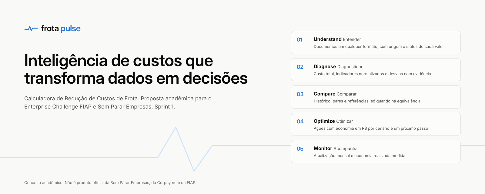

<p align="center"><a href="README.md">Português</a> · <b>English</b></p>

# Frota Pulse, Sprint 1: specifying a fleet-cost calculator

The planning sprint of Frota Pulse: the problem, the users, the product, the data model and the statistical methods, with synthetic data and reference code to check that the numbers add up. **There is no application in this sprint.**

> **Academic project.** FIAP Enterprise Challenge with Sem Parar Empresas, Artificial Intelligence degree, class 1TIAO. Team of five: Bruna Collavite, Fabio Guntovitch, Fabrizzio Riccelli, Gabriel Tamais and Natasha Zonta. All figures come from three fictitious fleets. Frota Pulse is a working name, not an official product.
>
> The implementation continues in [frota-pulse-sprint-2](https://github.com/fabrizzioriccelli/frota-pulse-sprint-2). Sprint 1 video: [YouTube, unlisted](https://youtu.be/MD6aKeIHl-Y).



## Problem

"The manager knows how much was spent, but not where money is being lost." We split the brief into five problems:

| | Problem | Consequence |
|---|---|---|
| P1 | Data fragmented across sources and formats | Slow, error-prone manual consolidation |
| P2 | Absolute cost does not measure efficiency | Without R$/km or km/L, vehicles are not comparable |
| P3 | High cost is not always waste | A vehicle that drives more costs more without being inefficient |
| P4 | Diagnosis without action | A finding with no next step and no value in reais changes nothing |
| P5 | Incomplete data on first use | Managers rarely have every document at hand |

## Proposed solution

A web calculator that accepts the fleet's documents as they are, consolidates total cost, detects deviations with evidence and returns an action plan with estimated savings. Its main differentiator is **saying how far each number can be trusted**: every estimate is a probable range, with the share that comes from documents and a confidence label.

| Capability | What it does |
|---|---|
| Understand | Reads spreadsheets, PDFs, photos, screenshots and statements; keeps the source of every value |
| Diagnose | Consolidates cost, computes normalized indicators (R$/km, km/L) and detects deviations |
| Compare | Against the fleet's own history and equivalent vehicles, only when the comparison is fair |
| Optimize | Recommends actions and estimates net savings in three scenarios |
| Follow up | Takes monthly updates and measures the savings that actually happened |

## What is in this repository

| Deliverable | Where |
|---|---|
| Problem, personas and 20 user stories prioritized with MoSCoW | [`docs/problema.md`](docs/problema.md), [`docs/personas.md`](docs/personas.md), [`docs/user-stories.md`](docs/user-stories.md) |
| Data model and dictionary (181 fields) | [`docs/modelagem-dados.md`](docs/modelagem-dados.md), [`data/dicionario-dados.csv`](data/dicionario-dados.csv) |
| Synthetic data: 3 fleets, 21,656 expenses, 34 planted situations and their answer key | [`data/sintetico/`](data/sintetico/), [`src/gerar_dados_sinteticos.py`](src/gerar_dados_sinteticos.py) |
| Diagnosis methods: CUSUM for drift, LMDI to split cost changes into volume, consumption and price | [`docs/diagnostico.md`](docs/diagnostico.md), [`src/calculos.py`](src/calculos.py) |
| Architecture, AI strategy, ingestion and data quality | [`docs/arquitetura.md`](docs/arquitetura.md), [`docs/estrategia-ia.md`](docs/estrategia-ia.md), [`docs/ingestao-qualidade.md`](docs/ingestao-qualidade.md) |
| Security and LGPD, adversarial test, validation, roadmap | [`docs/`](docs/) |
| Wireframes and visual identity | [`assets/wireframes/`](assets/wireframes/), [`docs/ux-identidade-visual.md`](docs/ux-identidade-visual.md) |

The documentation is in Portuguese.

## Getting started

Requires Python 3.11 or newer. The scripts are deterministic and reproduce the committed files.

```bash
git clone https://github.com/fabrizzioriccelli/frota-pulse-sprint-1.git
cd frota-pulse-sprint-1
pip install -r requirements.txt

python src/gerar_dados_sinteticos.py   # synthetic data and answer key, fixed seed
python src/exemplos_calculados.py      # worked examples of every method
python src/gerar_graficos.py           # SVG charts in assets/graficos/
python src/validar_entregaveis.py      # automatic checks of the deliverable
```

## My part

I structured the deliverable and the repository with Claude Code: the documentation, the data model, the reference code for the statistical methods and the visual materials.
