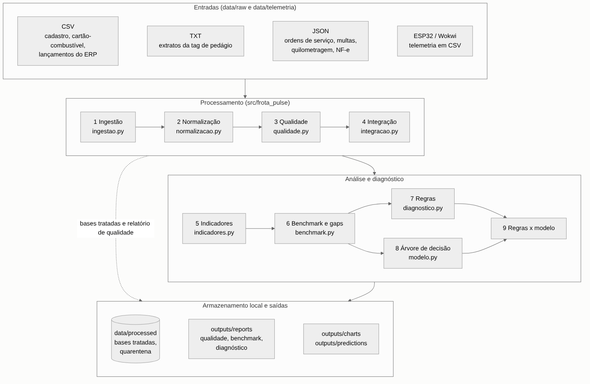
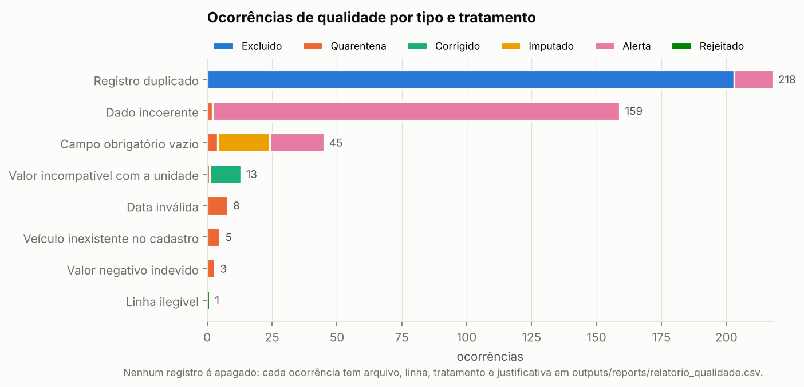
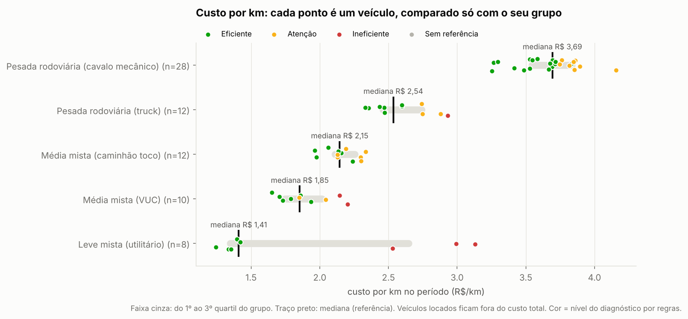

# FIAP - Faculdade de Informática e Administração Paulista

<p align="center">
<a href="https://www.fiap.com.br/">
  
</a>
</p>

<br>

# ENTERPRISE CHALLENGE - SEM PARAR EMPRESAS

## 👨‍🎓 Integrantes: 
- <a href="https://github.com/brunacollavite">Bruna Collavite</a> - RM 576285
- <a href="https://github.com/Guntooo">Fabio Guntovitch</a> - RM 575582
- <a href="https://github.com/fabrizzioriccelli">Fabrizzio Riccelli</a> - RM 576083
- <a href="https://github.com/GabrielTamaisFischer">Gabriel Tamais</a> - RM 574503
- <a href="https://github.com/natashazont">Natasha Zonta</a> - RM 574230

## 👩‍🏫 Professores:
### Tutor(a) 
- Sabrina Otoni
### Coordenador(a)
- <a href="https://www.linkedin.com/in/andregodoichiovato/">André Godoi Chiovato</a>


## 📜 Descrição

**Desafio.** A Sem Parar Empresas pediu uma ferramenta que mostre ao gestor de frota onde ele está perdendo dinheiro. Combustível, manutenção, pedágio, multas e impostos chegam em arquivos e sistemas diferentes; o gestor sabe quanto gastou, mas não sabe se está caro nem o que atacar primeiro.

**Solução.** O Frota Pulse (nome provisório) consolida os custos da frota, calcula indicadores comparáveis, compara cada veículo com veículos equivalentes e aponta onde está o desvio. Na Sprint 1, o grupo especificou o problema, os dados, a arquitetura e o plano ([README da Sprint 1](docs/sprint1/README-sprint1.md)).

**Objetivo da Sprint 2: inteligência e diagnóstico.** Transformar a especificação em um fluxo que funciona de ponta a ponta, em Python e localmente:

1. **Ingestão e normalização** de 12 arquivos em CSV, TXT e JSON, que imitam sistemas diferentes (cartão-combustível, tag de pedágio, oficinas, ERP, telemática), com colunas, datas e unidades padronizadas e seis categorias de custo.
2. **Qualidade:** 17 regras encontram duplicidades, valores negativos, campos vazios, veículos fora do cadastro, datas inválidas, unidades incompatíveis e leituras incoerentes. Nada é apagado: cada problema vira uma linha de relatório com arquivo, linha, tratamento e justificativa.
3. **Integração** de cadastro, custos, quilometragem e telemetria por veículo e mês.
4. **Telemetria com ESP32 no Wokwi:** velocidade, rotação, temperatura e nível de combustível, como entradas virtuais (potenciômetros), com alertas em LED, buzzer e Monitor Serial. O mesmo firmware, compilado no computador, gera 52.020 leituras para o pipeline.
5. **Benchmark estatístico** em grupos de mesmo porte, operação e categoria, com a mediana como referência, e **gap de eficiência** com a direção correta de cada indicador.
6. **Diagnóstico por regras** (Eficiente, Atenção, Ineficiente) com limites justificados pela distribuição dos dados.
7. **Modelo supervisionado** (árvore de decisão) que antecipa, pela telemetria, os meses de consumo acima da referência, comparado com as regras.

**Resultados, sobre dados simulados de três frotas fictícias (78 veículos):** 75.413 registros lidos, 452 ocorrências de qualidade, custo total consolidado de R$ 18,99 milhões; 44 veículos eficientes, 20 em atenção, 6 ineficientes e 8 sem referência; o modelo acertou 82,8% dos veículo-mês de teste, contra 73,6% de quem sempre prevê "dentro da referência", e concordou com as regras em 18 de 21 veículos. As divergências mostram onde o problema não é a condução: baixa utilização ou manutenção.

**Fora do escopo desta Sprint:** economia em reais, recomendações e leitura de PDF e imagem, previstas para a Sprint 3.

**Importante:** todos os dados são simulados. Não há dados de clientes da Sem Parar Empresas, e os resultados demonstram o método, não descrevem frotas reais.

**Vídeo da Sprint 2:** pendente de gravação e publicação (o link será incluído aqui e no arquivo de entrega).


## 📁 Estrutura de pastas

Dentre os arquivos e pastas presentes na raiz do projeto, definem-se:

- <b>docs</b>: documentação. `docs/sprint2/` traz a auditoria da Sprint 1, a metodologia, a arquitetura, o modelo, a telemetria, os testes, o Kanban, imagens e evidências; `docs/sprint1/` guarda o README da Sprint 1; os demais arquivos são a especificação da Sprint 1.

- <b>src</b>: código. `src/frota_pulse/` é o pipeline (um módulo por etapa); `src/executar_pipeline.py` executa tudo; `src/esp32/` tem o firmware, o projeto Wokwi e a compilação nativa; `src/simulacao/` gera as fontes brutas e a telemetria; os scripts da raiz de `src/` são da Sprint 1.

- <b>data</b>: `raw/` são os arquivos de entrada, nunca alterados; `telemetria/` é o CSV do ESP32; `processed/` são as bases tratadas, a quarentena e a base consolidada; `sintetico/` é a massa da Sprint 1, origem de tudo; `dicionario-dados-sprint2.csv` descreve os campos.

- <b>outputs</b>: resultados gerados pelo pipeline: `reports/` (qualidade, indicadores, benchmark, rankings, diagnóstico, comparação), `predictions/` (previsões e métricas do modelo) e `charts/` (gráficos).

- <b>notebooks</b>: `sprint2_demonstracao.ipynb`, que executa as etapas uma a uma e mostra os resultados.

- <b>tests</b>: 36 testes automatizados (pytest).

- <b>assets</b>: logo, capa, diagramas, gráficos e wireframes da Sprint 1.

- <b>README.md</b>: guia e explicação geral do projeto.


## 📎 Links e Observações

### Listagem de Links

| Item | Link |
|---|---|
| Repositório (privado) | https://github.com/fabrizzioriccelli/1TIAO-ENTERPRISE-CHALLENGE- |
| Vídeo da Sprint 2 | Pendente: ainda não gravado nem publicado |
| Projeto no Wokwi | Pendente: o projeto deve ser salvo no wokwi.com com os arquivos de `src/esp32/` ([passo a passo](docs/sprint2/telemetria-esp32.md#5-como-simular-no-wokwi)) |
| Kanban da Sprint 2 (Trello, privado) | https://trello.com/b/fGYNJgyW/enterprise-challenge-sem-parar-sprint-2 (cópia em [docs/sprint2/kanban-sprint2.csv](docs/sprint2/kanban-sprint2.csv)) |
| Vídeo da Sprint 1 (YouTube, não listado) | https://youtu.be/MD6aKeIHl-Y (narração de Bruna Collavite) |
| Kanban da Sprint 1 (Trello, privado) | https://trello.com/b/ytvX15Q6/enterprise-challenge-sem-parar-sprint-1 |

### Explicação de decisões técnicas

- **Pipeline local em Python, sem banco nem nuvem.** A Sprint pede inteligência e diagnóstico; infraestrutura agora só adicionaria pontos de falha. As etapas leem e gravam arquivos e seguem a arquitetura da Sprint 1, que recebe o banco e a interface depois ([arquitetura](docs/sprint2/arquitetura.md)).
- **Leitura como texto e nenhum registro apagado.** O valor original fica ao lado do tratado, e todo registro guarda arquivo e linha de origem.
- **Comparar só o comparável.** Grupos por porte, operação e categoria; mínimo de 5 veículos; veículos locados fora do custo total, porque a mensalidade embute manutenção e seguro.
- **Mediana como referência**, porque um veículo fora do padrão desloca a média.
- **Gap positivo sempre significa pior.** No consumo (km/L), em que maior é melhor, a fórmula é invertida.
- **Custo total alto não basta para ser ineficiente.** O diagnóstico usa custo por km e consumo, nunca o custo absoluto.
- **O modelo prevê o que a telemetria consegue ver.** O primeiro alvo (a regra completa de custo) foi descartado porque a telemetria não antecipa faturas de manutenção; o alvo adotado é o consumo do mês ([modelo](docs/sprint2/machine-learning.md)).
- **Separação treino e teste por veículo**, para que o modelo seja avaliado em veículos que nunca viu.
- **Entradas virtuais declaradas.** Os potenciômetros do Wokwi representam sinais que, num veículo real, viriam do barramento do motor; não há sensor físico simulado.

### Observações Gerais

*Indique obrigatoriamente no campo abaixo a decisão da equipe quanto à participação no festival FIAP NEXT:*

* **Participação na Competição:** [x] Sim, aceitamos participar / [ ] Não vamos participar.
* **Integrantes:** Bruna Collavite (RM 576285), Fabio Guntovitch (RM 575582), Fabrizzio Riccelli (RM 576083), Gabriel Tamais (RM 574503) e Natasha Zonta (RM 574230).
* Projeto acadêmico. "Sem Parar Empresas" e os nomes de produtos citados pertencem aos seus titulares; o Frota Pulse não é produto oficial.

### Detalhamento da ideia

#### Arquitetura e tecnologias



Arquivos de entrada → ingestão → normalização → qualidade → integração → indicadores → benchmark → gap → diagnóstico por regras → modelo → resultados. Cada etapa é um módulo de `src/frota_pulse/`; responsabilidades e entradas e saídas em [docs/sprint2/arquitetura.md](docs/sprint2/arquitetura.md).

| Tecnologia | Uso |
|---|---|
| Python 3.13, pandas 3.0, NumPy 2.5 | Leitura, transformação e cálculo |
| scikit-learn 1.9 | Árvore de decisão, regressão logística e floresta aleatória (comparação) |
| matplotlib 3.11 | Gráficos |
| pytest 9.1 | Testes automatizados |
| C++ (Arduino) para ESP32 e Wokwi | Firmware de telemetria; compilado com g++ para gerar o CSV |

#### Arquivos de entrada e dicionário de dados

| Arquivo em `data/raw/` | Formato | Origem simulada |
|---|---|---|
| `cadastro/cadastro_frota.csv` | CSV | Cadastro da frota: identificador comum `codigo_veiculo`, porte, operação, categoria |
| `combustivel/abastecimentos_cartao*.csv` | CSV com ponto e vírgula | Extrato do cartão-combustível e um reenvio do mesmo extrato |
| `combustivel/notas_fiscais_combustivel.json` | JSON | NF-e das mesmas compras |
| `pedagio/extrato_tag_EMP-*.txt` | TXT com cabeçalho e rodapé | Extrato da tag de pedágio |
| `manutencao/ordens_servico.json` | JSON aninhado | Ordens de serviço com itens |
| `multas/notificacoes_multas.json` | JSON | Notificações de multa |
| `financeiro/lancamentos_erp.csv` | CSV | ERP: IPVA, seguro, locação e outros, com competência mm/aaaa |
| `operacao/quilometragem_telematica.json` | JSON | Quilometragem mensal, em metros |
| `../telemetria/telemetria_esp32.csv` | CSV | Monitor Serial do ESP32 |

O dicionário ([data/dicionario-dados-sprint2.csv](data/dicionario-dados-sprint2.csv)) descreve 103 campos: entrada, telemetria e base consolidada, com tipo, unidade, obrigatoriedade, exemplo e tratamento quando ausente.

#### Normalização e regras de qualidade

Colunas renomeadas para um esquema único; "R$ 1.234,56" e "1234.56" viram o mesmo número; datas convertidas de forma estrita ("31/02/2026" vira ausente, não março); metros convertidos em km; competência em AAAA-MM; categoria do ERP lida do texto da conta. As 17 regras (Q00 a Q16) e suas justificativas estão em [docs/sprint2/metodologia.md](docs/sprint2/metodologia.md#4-regras-de-qualidade). Resultado: 452 ocorrências, das quais 203 duplicidades excluídas, 193 alertas, 23 em quarentena, 20 imputações, 12 correções e 1 linha rejeitada. As 21 inconsistências injetadas pelo grupo ([gabarito](data/raw/gabarito_inconsistencias_sprint2.csv)) são todas encontradas.



#### Indicadores, benchmark e gap

| Indicador | Fórmula | Melhor quando |
|---|---|---|
| Custo por km | custo dos meses com km ÷ km desses meses | menor |
| Consumo | km ÷ litros | maior |
| Preço médio | custo de combustível ÷ litros | menor |
| Participação da categoria | custo da categoria ÷ custo total × 100 | - |

Gap percentual: (veículo − referência) ÷ referência × 100 quando menor é melhor, e (referência − veículo) ÷ referência × 100 no consumo. Exemplo: um truck com 3,07 km/L num grupo de mediana 3,56 km/L tem gap de +13,6% (pior). Para cada grupo, o pipeline publica média, mediana, quartis, mínimo e máximo ([benchmark_grupos.csv](outputs/reports/benchmark_grupos.csv)) e os rankings de veículos e de categorias. Nos 5 grupos com referência válida (de 7), os gaps entre veículos têm mediana de 4,3% (custo) e 4,8% (consumo) e percentil 90 de 12,7% e 9,8%.



#### Diagnóstico por regras

| Nível | Condição sobre o pior gap (custo por km ou consumo) |
|---|---|
| Eficiente | até 5%: dentro da variação típica entre veículos parecidos |
| Atenção | de 5% a 15% |
| Ineficiente | acima de 15%: fora do que ocorre com 9 em cada 10 veículos do grupo |
| Sem referência | grupo com menos de 5 comparáveis ou veículo sem km |

Os três veículos mais caros por km (B-V28, B-V29 e B-V30, de 79% a 122% acima da mediana) rodam menos de 25% da quilometragem do grupo, e a justificativa registra "baixa utilização". O veículo de maior custo total (C-V02, R$ 752 mil) está em Atenção, não em Ineficiente, porque roda 195 mil km.


#### Modelo supervisionado

| Elemento | Definição |
|---|---|
| Unidade | Veículo-mês: 835 linhas de 70 veículos |
| Rótulo | 1 se o consumo do mês ficou mais de 5% pior que a mediana do grupo no mesmo mês (26% dos casos) |
| Atributos | Telemetria do mês (% de rotação acima da faixa verde, % em marcha lenta, % com excesso de velocidade, velocidade média, alertas e máxima de temperatura), idade e grupo |
| Separação | 30% dos veículos de cada grupo para teste, com semente fixa; nenhum veículo nos dois lados |
| Resultado no teste | Acurácia 82,8% (linha de base 73,6%), recall 72,7%, precisão 65,8% |

A marcha lenta responde por 63% da importância, seguida da rotação alta (20%). Regras e modelo concordam em 18 de 21 veículos; B-V29, B-V12 e C-V21 divergem porque o desvio vem de baixa utilização, manutenção ou consumo sem sinal de condução fora do padrão. Exemplos de acerto e erro, a árvore completa e o experimento descartado estão em [docs/sprint2/machine-learning.md](docs/sprint2/machine-learning.md).


#### Telemetria com ESP32

Circuito: três potenciômetros e um deslizante (velocidade, rotação, temperatura, combustível), botões de modo e de veículo, LEDs verde, amarelo e vermelho e buzzer. Limites por porte: rotação de 4.500, 2.600 e 2.300 RPM; velocidade de 60 km/h urbano e 90 ou 110 km/h em rodovia; temperatura de 105 °C; combustível de 15%. Leituras do lote: 45.692 normais, 5.259 em atenção e 1.069 críticas. Detalhes, justificativas e o [exemplo do Monitor Serial](docs/sprint2/evidencias/monitor_serial_demo.txt) em [docs/sprint2/telemetria-esp32.md](docs/sprint2/telemetria-esp32.md).


*Diagrama gerado a partir de `src/esp32/wokwi/diagram.json`; não é captura do Wokwi. As capturas da simulação no Wokwi estão pendentes.*

#### Exemplo de entrada e saída

Entrada (linha do extrato do cartão, `data/raw/combustivel/abastecimentos_cartao.csv`, linha 3754):

```
DSP-A-000201;COMPRA;22/12/2025 06:24;A-V04;GASOLINA COMUM;34,27;620,3;21258,00;;POSTO-A004;N
```

Saída no relatório de qualidade: regra Q07, `CORRIGIDO`, "preço e valor exportados em centavos; divididos por 100", resultando em R$ 6,203/L e R$ 212,58 (34,27 L × R$ 6,203). Saída do diagnóstico (`outputs/reports/indicadores_e_diagnostico_veiculo.csv`):

| Veículo | Grupo | km | Custo por km | Consumo | Gap custo | Gap consumo | Nível |
|---|---|---|---|---|---|---|---|
| B-V23 | Leve mista (utilitário) | 29.815 | R$ 1,33 | 9,46 km/L | −5,4% | −1,3% | Eficiente |
| C-V33 | Pesada rodoviária (truck) | 84.255 | R$ 2,75 | 3,07 km/L | +8,4% | +13,6% | Atenção |
| B-V28 | Leve mista (utilitário) | 3.827 | R$ 3,13 | 9,42 km/L | +121,9% | −0,9% | Ineficiente (baixa utilização) |

Todos os resultados estão em [outputs/reports/resultados_sprint2.md](outputs/reports/resultados_sprint2.md), gerado pelo pipeline.

#### Limitações

- Dados simulados pelo grupo; as regras de qualidade foram escritas conhecendo os problemas injetados.
- Grupos de 8 a 28 veículos; a EMP-A não tem referência válida. Limites de 5% e 15% iguais para todos os grupos.
- A relação entre telemetria e consumo foi construída na simulação: o modelo mostra que o fluxo funciona, não que esses sinais preveem consumo em frotas reais com essa precisão. Teste com 21 veículos, sem validação cruzada.
- O firmware foi validado por compilação nativa e testes; a compilação para o ESP32 e a execução no Wokwi não puderam ser feitas neste ambiente ([testes](docs/sprint2/testes.md#4-o-que-não-foi-possível-testar-aqui)).

Situação de cada item pedido na Sprint 2, com evidência: [docs/sprint2/checklist-entrega.md](docs/sprint2/checklist-entrega.md).

### Avanços e ajustes

| Na Sprint 1 | Na Sprint 2 |
|---|---|
| Especificação, sem código da aplicação | Pipeline executável de ponta a ponta em cerca de 6 segundos |
| Massa simulada em tabelas já limpas | 12 arquivos em CSV, TXT e JSON com formatos diferentes e 21 inconsistências novas |
| 13 regras de qualidade descritas | 17 regras implementadas e testadas, com relatório por ocorrência |
| Sem telemetria | Firmware do ESP32 com alertas, projeto Wokwi e 52.020 leituras |
| Benchmark e indicadores descritos | Grupos, estatísticas, gaps com direção, rankings e gráficos calculados |
| "Não há modelo treinado nesta Sprint" | Árvore de decisão treinada, avaliada e comparada com as regras |
| Validador da documentação, sem testes de código | 36 testes automatizados e conferências manuais ([testes](docs/sprint2/testes.md)) |

Ajustes em relação ao que a Sprint 1 previa ([auditoria](docs/sprint2/auditoria-sprint1.md)): os grupos de benchmark passaram a separar automóvel de utilitário, porque juntos eram injustos (11,5 contra 8,8 km/L); o banco de dados, o login e a estimativa com perguntas guiadas, previstos para a Sprint 2 no roadmap original, ficaram para depois, porque o enunciado desta Sprint pede inteligência e diagnóstico; o custo total calculado a partir dos arquivos brutos difere do da Sprint 1 em −0,06% (EMP-B) e −0,16% (EMP-C), pelos registros em quarentena.


## 🔧 Como executar o código

**Pré-requisitos:** Python 3.11 ou mais recente (testado com 3.13) e as bibliotecas de [requirements.txt](requirements.txt). Para regenerar a telemetria, um compilador C++ (g++). Para o ESP32, uma conta no [Wokwi](https://wokwi.com).

```bash
git clone https://github.com/fabrizzioriccelli/1TIAO-ENTERPRISE-CHALLENGE-.git
cd 1TIAO-ENTERPRISE-CHALLENGE-
python -m venv .venv
source .venv/bin/activate          # no Windows: .venv\Scripts\activate
pip install -r requirements.txt

python src/executar_pipeline.py    # executa todas as etapas e grava data/processed e outputs
python -m pytest                   # 36 testes
```

Os arquivos de entrada já estão no repositório. Para gerá-los de novo a partir da massa da Sprint 1 (semente fixa, mesmo resultado):

```bash
python src/gerar_dados_sinteticos.py               # massa da Sprint 1 em data/sintetico/
python src/simulacao/gerar_perfis_telemetria.py    # perfis de condução por veículo-mês
python src/simulacao/gerar_telemetria.py           # compila o firmware com g++ e gera data/telemetria/
python src/simulacao/gerar_fontes_brutas.py        # arquivos de data/raw/ e o gabarito
python src/executar_pipeline.py
```

**Notebook:** abra `notebooks/sprint2_demonstracao.ipynb` no Jupyter ou no VS Code e execute as células em ordem.

**ESP32 no Wokwi:** crie um projeto ESP32 (Arduino), substitua `diagram.json` pelo de `src/esp32/wokwi/`, cole o `telemetria_frota.ino` e adicione `limites.h`, `perfil.h` e `perfis_demo.h` de `src/esp32/firmware/telemetria_frota/`. Gire os potenciômetros para provocar os alertas e use os botões para trocar de modo e de veículo ([instruções completas](docs/sprint2/telemetria-esp32.md#5-como-simular-no-wokwi)).


## 🗃 Histórico de lançamentos

* 0.2.0 - 18/11/2026
    * Sprint 2: ingestão de CSV, TXT e JSON, regras de qualidade, integração, telemetria com ESP32, benchmark, gaps, diagnóstico por regras, modelo supervisionado e testes.
* 0.1.0 - 09/10/2026
    * Sprint 1: especificação do problema, dados simulados, arquitetura, User Stories e plano.

---


## 📋 Licença

<p xmlns:cc="http://creativecommons.org/ns#" xmlns:dct="http://purl.org/dc/terms/"><a property="dct:title" rel="cc:attributionURL" href="https://github.com/SabrinaOtoni/TEMPLATE-FIAP-GRAD-ON-IA">MODELO GIT FIAP</a> por <a rel="cc:attributionURL dct:creator" property="cc:attributionName" href="https://fiap.com.br">FIAP</a> está licenciado sobre <a href="http://creativecommons.org/licenses/by/4.0/?ref=chooser-v1" target="_blank" rel="license noopener noreferrer" style="display:inline-block;">Attribution 4.0 International</a>.</p>
