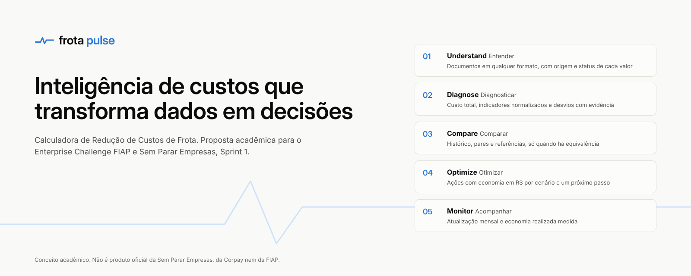
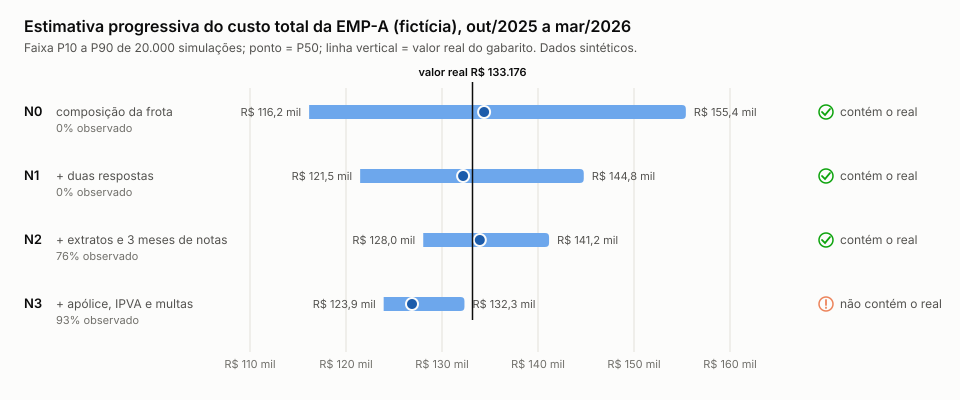
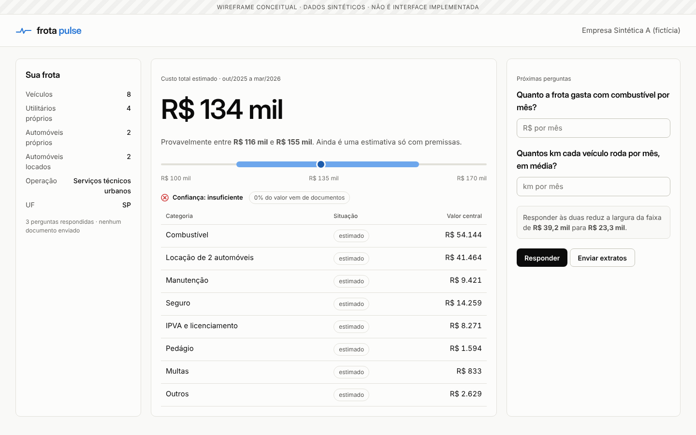
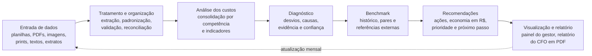

# FIAP - Faculdade de Informática e Administração Paulista

<p align="center">
<a href="https://www.fiap.com.br/">
  
</a>
</p>

<br>

# Frota Pulse: Calculadora de Redução de Custos de Frota

Enterprise Challenge FIAP e Sem Parar Empresas · Sprint 1 · Turma 1TIAO

## 👨‍🎓 Integrantes: 
- <a href="https://github.com/brunacollavite">Bruna Collavite</a> - RM 576285
- <a href="https://github.com/Guntooo">Fabio Guntovitch</a> - RM 575582
- <a href="https://github.com/fabrizzioriccelli">Fabrizzio Riccelli</a> - RM 576083
- <a href="https://github.com/GabrielTamaisFischer">Gabriel Tamais</a> - RM 574503
- Natasha Zonta - RM 574230

## 👩‍🏫 Professores:

### Tutor(a)
- Sabrina Otoni
  
### Coordenador(a)
- <a href="https://www.linkedin.com/in/andregodoichiovato/">André Godoi Chiovato</a>

## 📜 Descrição



Este README reúne todos os itens pedidos na Sprint 1. Cada seção traz o essencial e indica o documento com o detalhamento. A Sprint 1 é de planejamento: **não há aplicação implementada**. Os números citados vêm de dados **simulados** de três frotas fictícias.

### 1. O problema e o entendimento do desafio

Nas palavras do briefing da Sem Parar Empresas: "O gestor sabe quanto gastou — mas não onde está perdendo." Combustível, manutenção, pedágio, multas e impostos chegam em planilhas, sistemas, PDFs, fotos, prints e extratos diferentes. Mesmo com os dados em mãos, o gestor não enxerga o custo total da operação, não sabe quais custos atacar primeiro, não tem referência para saber se está caro e não consegue transformar a análise em ações com valor em reais.

Organizamos o problema em cinco partes:

| Código | Problema | Consequência para o gestor |
|---|---|---|
| P1 | Dados fragmentados em fontes e formatos diferentes | Consolidação manual, demorada e sujeita a erro |
| P2 | Custo absoluto não mede eficiência | Sem R$/km ou km/L, frotas e veículos não são comparáveis |
| P3 | Custo alto nem sempre é desperdício | Um veículo que roda mais custa mais sem ser ineficiente |
| P4 | Diagnóstico sem ação | Achado sem próximo passo e sem valor em R$ não muda a gestão |
| P5 | Dados incompletos no primeiro uso | O gestor raramente tem todos os documentos à mão |

Detalhamento, objetivos, escopo e premissas: [docs/problema.md](docs/problema.md).

### 2. Usuários e necessidades

| Perfil | Quem é | O que precisa |
|---|---|---|
| **Gestor de frota** | Responsável pela operação diária dos veículos | Enviar os documentos como estão, ver o custo consolidado, saber onde está perdendo e o que fazer primeiro |
| **CFO e liderança** | Decide orçamento e investimentos | Relatório curto com custo total, oportunidades em R$, payback e grau de confiança dos números |
| **Sem Parar Empresas** | Dona da ferramenta | Gerar valor no primeiro uso, recorrência, leads qualificados com autorização e benchmarks melhores com o tempo |

As personas são **hipotéticas**, construídas a partir do briefing; não houve entrevistas. O roteiro de entrevista para validá-las está em [docs/personas.md](docs/personas.md).

### 3. Solução proposta

O **Frota Pulse** (nome provisório, sem relação com marcas oficiais) é uma calculadora web que recebe os documentos da frota, consolida os custos, aponta as ineficiências com evidência e entrega um plano de ação com economia estimada em reais. Ela funciona com poucos dados desde o primeiro uso e fica mais precisa a cada informação enviada.

| Capacidade | O que faz |
|---|---|
| **Entender** | Recebe planilhas, PDFs, fotos, prints, textos e extratos; extrai, padroniza, valida e guarda a origem de cada valor |
| **Diagnosticar** | Consolida o custo total, calcula indicadores normalizados (R$/km, km/L, custo por veículo) e detecta desvios |
| **Comparar** | Compara com o histórico da própria frota, com veículos equivalentes e com referências externas, só quando a comparação é justa |
| **Otimizar** | Recomenda ações, estima a economia líquida em três cenários, prioriza e indica o próximo passo |
| **Acompanhar** | Recebe atualizações mensais, mostra a evolução e mede a economia que de fato aconteceu |

**Benefícios.** O gestor ganha uma visão consolidada sem montar planilhas e sabe o que atacar primeiro. O CFO recebe números com premissas visíveis e grau de confiança. A Sem Parar Empresas ganha recorrência de uso, oportunidades comerciais autorizadas pelo cliente e referências que melhoram com o uso.

**Diferencial.** Dizer quanto se pode confiar em cada número: toda estimativa aparece como faixa provável, com a parte que vem de documento e um selo de confiança. Detalhamento e diferenciais avaliados: [docs/solucao.md](docs/solucao.md).

### 4. User Stories selecionadas

O grupo pretende atender **as 20 User Stories** fornecidas pela Sem Parar Empresas. A prioridade segue o método MoSCoW: 14 *Must*, 4 *Should* e 2 *Could*. A matriz completa, com critério de aceite, dependências e Sprint prevista, está em [docs/user-stories.md](docs/user-stories.md).

| User Story | Necessidade | Como a solução responde | Prioridade |
|---|---|---|---|
| US-GF-01 | Enviar dados em qualquer formato | Ingestão de planilha, PDF, imagem, print, texto e extrato, com extração automática e revisão só do que tiver baixa confiança | Must |
| US-GF-02 | Ver o custo total consolidado | Soma por competência, sem duplicidades, com cada valor ligado à sua origem | Must |
| US-GF-03 | Saber onde estão as ineficiências | Indicadores normalizados, detecção de desvios e separação entre volume, consumo e preço | Must |
| US-GF-04 | Comparar com benchmark | Hierarquia de referências e regras de quando não comparar | Must |
| US-GF-05 | Recomendações por nível de ineficiência | Catálogo de 14 recomendações ligadas a cada tipo de achado | Must |
| US-GF-06 | Ver a economia potencial em R$ | Economia bruta e líquida por ação, em três cenários | Must |
| US-GF-07 | Saber o próximo passo | Priorização por valor, confiança, urgência e esforço, com uma ação em destaque | Must |
| US-GF-08 | Atualizar os dados periodicamente | Envio mensal, comparação entre períodos e medição da economia realizada | Should |
| US-GF-09 | Ter sempre uma estimativa | Estimativa progressiva em faixa, que estreita a cada informação | Must |
| US-GF-10 | Receber perguntas sobre o que informar | Sugestão da próxima informação que mais reduz a incerteza por esforço | Must |
| US-CF-01 | Relatório executivo | Relatório de uma página, exportável em PDF | Must |
| US-CF-02 | Economia potencial em R$ | Cenários com payback, ROI e análise de sensibilidade | Must |
| US-CF-03 | Visão consolidada sem análise manual | Indicadores com definição fixa e painel consolidado | Must |
| US-CF-04 | Principais oportunidades de redução | Lista priorizada de oportunidades com valor e confiança | Must |
| US-SP-01 | Recomendações conectadas às soluções da empresa | Associação contextual da ação à solução do portfólio, sem promessa de economia | Should |
| US-SP-02 | Identificar clientes com oportunidades | Painel interno com oportunidades de clientes que autorizaram contato | Could |
| US-SP-03 | Melhorar benchmarks com o uso | Grupos de referência entre clientes, anônimos e com tamanho mínimo | Could |
| US-SP-04 | Valor no primeiro uso | Primeira estimativa com três perguntas | Must |
| US-SP-05 | Retorno periódico do gestor | Lembretes, novos achados e economia realizada a cada atualização | Should |
| US-SP-06 | Ter as informações do cliente como lead | Cadastro de contato sempre registrado; uso comercial só com autorização do cliente, conforme a LGPD | Should |

### 5. Estruturação dos dados

O centro do modelo é a **despesa**: todo valor tem categoria, mês de competência, veículo (quando houver) e a **origem** (arquivo e linha de onde veio). Cada valor também tem um **status**: observado, corrigido, imputado, estimado ou não disponível. O dicionário descreve **181 campos** com tipo, unidade, obrigatoriedade, regra de validação, origem, sensibilidade, exemplo e o que fazer quando faltar: [data/dicionario-dados.csv](data/dicionario-dados.csv).

| Categoria de custo | Dados necessários |
|---|---|
| Combustível | Data, veículo, litros, preço por litro, tipo de combustível, odômetro, posto |
| Manutenção | Data, veículo, tipo (preventiva, corretiva, pneus, sinistro), sistema, valor, oficina |
| Pedágio | Data e hora, veículo, concessionária, praça, eixos cobrados, meio de pagamento, viagem |
| Multas | Data, veículo, gravidade, valor, prazo de indicação do condutor, situação |
| Impostos | IPVA, licenciamento e taxas, com o período a que se referem |
| Seguro e outros | Apólice, cobertura, período; locação, lavagem, estacionamento |
| Contexto | Categoria do veículo, quilometragem mensal, modalidade de operação, UF |

**Exemplo de dados simulados** (tabela `despesas`, frota fictícia EMP-B):

| despesa_id | veiculo_id | categoria_custo | subcategoria | data_evento | competência | valor_brl | status_valor |
|---|---|---|---|---|---|---|---|
| DSP-B-000001 | B-V01 | COMBUSTIVEL | diesel_s10 | 2025-07-02 | 2025-07 | 540,41 | OBSERVADO |
| DSP-B-000006 | B-V01 | PEDAGIO | passagem_tag | 2025-07-23 | 2025-07 | 23,22 | OBSERVADO |
| DSP-B-000025 | B-V02 | MANUTENCAO | revisao_completa | 2025-07-24 | 2025-07 | 4.844,80 | OBSERVADO |
| DSP-B-000920 | B-V30 | MULTA | infracao_transito | 2025-07-24 | 2025-07 | 156,18 | OBSERVADO |
| DSP-B-010538 | B-V01 | TRIBUTO | ipva | 2025-01-15 | 2025-01 a 2025-12 | 1.177,28 | OBSERVADO |

**Significado das principais variáveis:** `categoria_custo` é a categoria usada nos indicadores; `competencia` é o período a que o custo pertence, que pode ser diferente da data de pagamento (o IPVA pago em janeiro é distribuído pelos 12 meses); `status_valor` diz se o valor veio de documento ou foi estimado; `origem_id` liga o valor ao arquivo de onde ele saiu.

**Massa simulada.** Três frotas fictícias (8, 30 e 40 veículos), 21.656 despesas e 34 situações planejadas, como arquivo enviado duas vezes, odômetro errado, cobrança duplicada de pedágio e custos altos que são justificáveis. Um gabarito registra cada situação para testar as regras. Nenhum dado é real. Detalhamento: [docs/modelagem-dados.md](docs/modelagem-dados.md).

### 6. Estratégia de entrada de dados

| Formato | Como vira dado utilizável |
|---|---|
| Planilhas (CSV, XLSX) | Leitura estruturada, com mapeamento de colunas confirmado pelo usuário na primeira vez |
| Extratos (tag de pedágio, cartão de combustível) | Leitores específicos por emissor |
| PDF com texto (faturas, apólices, notas) | Extração de texto e tabelas |
| PDF escaneado, imagens e prints | Reconhecimento de texto (OCR) e extração orientada por esquema, com confiança por campo |
| Texto livre (mensagem, e-mail) | Regras para encontrar valor, data, veículo e categoria |
| Nota fiscal eletrônica (XML) | Leitura estruturada; o código ANP do produto identifica o combustível |

Depois da extração, os dados passam por **padronização** (datas, valores, placas, categorias), **validação** (13 regras, como data futura, valor negativo, abastecimento acima do tanque e cobrança duplicada), **reconciliação** entre fontes e **revisão humana** do que tiver confiança abaixo de 0,80. Valores duvidosos ficam em quarentena e não entram nos totais até serem confirmados. Detalhamento: [docs/ingestao-qualidade.md](docs/ingestao-qualidade.md).

### 7. Diagnóstico dos custos

1. **Consolidação:** soma dos custos por mês de competência, sem duplicidades, separando o custo próprio do custo pago por terceiros.
2. **Indicadores:** 12 indicadores com definição, fórmula e unidade fixas, como custo total, custo por veículo·mês, custo por km, participação de cada categoria, rendimento em km/L e preço pago em relação à referência.
3. **Desvios:** comparação robusta com veículos equivalentes e detecção de mudança persistente ao longo do tempo (método CUSUM).
4. **Separação de causas:** o custo de combustível é dividido em quilometragem, consumo e preço, para não confundir volume com desperdício.
5. **Evidência:** cada achado é classificado em observação, anomalia, hipótese ou oportunidade validada, e o diagnóstico recebe um selo de confiança.
6. **Prioridade:** o gestor vê primeiro as despesas com maior economia líquida, maior confiança e menor esforço.

Detalhamento: [docs/diagnostico.md](docs/diagnostico.md) e [docs/benchmarks.md](docs/benchmarks.md).

### 8. Recomendações e plano de ação

Cada tipo de achado tem uma recomendação de ação, com responsável sugerido e indicador de acompanhamento. A economia é calculada em três cenários (conservador, base e otimista), que diferem pelo nível de evidência, já descontando o custo de executar cada ação. As ações são ordenadas por prioridade e o produto destaca **um próximo passo**.

| Exemplo de achado | Ação recomendada | Solução do portfólio, quando fizer sentido |
|---|---|---|
| Multa por não indicação do condutor no prazo | Rotina de indicação do condutor em até 30 dias | Gestor de Multas |
| Preço de combustível acima da referência da frota | Política de abastecimento e rede preferencial | Multiabastece |
| Cobrança de eixo suspenso em retorno vazio | Declarar eixos e contestar cobranças indevidas | Tag Sem Parar |
| Viagem de carga sem registro de Vale-Pedágio | Verificar contratos com embarcadores | Vale-Pedágio |
| Manutenção corretiva elevada | Plano de manutenção preventiva | Gestão de Manutenção |

A solução do portfólio aparece como apoio à ação, com o aviso de que não há garantia de economia, e nenhum percentual de redução é atribuído aos produtos. Na frota fictícia maior, o cenário-base indica cerca de R$ 120 mil por ano de economia líquida; na frota média, o resultado é negativo, e a ferramenta mostra isso em vez de inventar economia. Detalhamento: [docs/economia-recomendacoes.md](docs/economia-recomendacoes.md).

### 9. Tratamento de dados incompletos

A ferramenta sempre devolve uma **estimativa em faixa** (valor provável mínimo e máximo), que estreita conforme o usuário fornece mais informações:

| Nível | O que o usuário informou | Faixa do custo de 6 meses (frota fictícia de 8 veículos) |
|---|---|---|
| N0 | Composição da frota, segmento e UF (3 perguntas) | R$ 116 mil a R$ 155 mil |
| N1 | + km médio e gasto mensal com combustível | R$ 121 mil a R$ 145 mil |
| N2 | + extratos, faturas de locação e algumas notas de oficina | R$ 128 mil a R$ 141 mil |
| N3 | + apólice, IPVA e multas | R$ 124 mil a R$ 132 mil |

As lacunas aparecem como **estimadas**, nunca como zero. No nível N3, o valor real ficou fora da faixa; o caso é mostrado de propósito, e a calibração foi testada em 280 simulações.



### 10. Orientação ao usuário

A cada etapa, a ferramenta calcula **qual informação reduz mais a incerteza em relação ao esforço** de obtê-la e faz essa pergunta primeiro, em linguagem simples. Exemplo na frota fictícia: "Enviar a apólice de seguro reduz a incerteza da sua estimativa em cerca de R$ 3 mil". O diagnóstico também mostra o que falta para cada comparação ("faltam 2 veículos para comparar com o grupo") e o selo de confiança indica qual dimensão está fraca (dados desatualizados, lacunas, inconsistências). Telas conceituais: [docs/ux-identidade-visual.md](docs/ux-identidade-visual.md).



### 11. Arquitetura da solução



| Camada | Módulos | Tecnologia proposta |
|---|---|---|
| Interface | Telas do gestor, do CFO e da Sem Parar Empresas; fila de revisão | Aplicação web |
| Regras de negócio | Cálculo, estimativa, benchmark, diagnóstico, recomendações, relatórios, acompanhamento | Python com FastAPI, em monólito modular |
| Dados | Ingestão, extração, qualidade, consentimento e auditoria | PostgreSQL com isolamento por cliente; arquivos em armazenamento de objetos cifrado |
| Serviços externos (propostos) | OCR e IA para leitura de documentos, referências de preço da ANP | Adaptadores substituíveis |

A IA é usada onde há ganho claro: leitura de documentos, classificação de despesas, detecção de padrões e explicação em linguagem natural. **Os cálculos financeiros são determinísticos**, e todo número de um texto gerado é conferido contra o cálculo. Não há modelo treinado nesta Sprint. Diagramas completos e decisões: [docs/arquitetura.md](docs/arquitetura.md) e [docs/estrategia-ia.md](docs/estrategia-ia.md).

### 12. Segurança e dados do cliente

Login por provedor de identidade, perfis de acesso (gestor, CFO, analista da Sem Parar Empresas), isolamento total entre clientes no banco, dados cifrados e registro de auditoria de acessos e exportações. A integridade vem da origem guardada em cada valor, do hash de cada arquivo recebido e do histórico de correções. Os **dados de contato** do cliente ficam registrados para o relacionamento de serviço; o uso para contato comercial e o uso anônimo em benchmarks dependem de duas autorizações separadas, opcionais e revogáveis, conforme a LGPD. Placas, condutores e apólices são pseudonimizados na base de análise. Detalhamento: [docs/seguranca-lgpd.md](docs/seguranca-lgpd.md).

### 13. Planejamento das próximas etapas

| Sprint | Foco | Principais entregas |
|---|---|---|
| Sprint 1 | Especificação (esta entrega) | Documentação, dados simulados, arquitetura e plano |
| Sprint 2 | Fundação de dados e primeira estimativa | Banco de dados, envio de planilhas e extratos, regras de qualidade, indicadores básicos, estimativa com perguntas guiadas, login |
| Sprint 3 | Diagnóstico, benchmark e recomendações | Leitura de PDF e imagem, detecção de desvios, benchmarks, recomendações e cenários de economia |
| Sprint 4 | Protótipo funcional e validação | Relatório em PDF, atualização mensal, painel da Sem Parar Empresas, testes de segurança e testes com gestores |

A quantidade de Sprints é uma hipótese até a confirmação do calendário oficial.

Cada integrante é responsável por um papel nas próximas Sprints e apresenta a parte correspondente no vídeo. A distribuição foi definida em 9 out. 2026 e pode ser revista pelo grupo.

**Responsabilidades dos integrantes**

| Papel | Responsabilidades | Integrante |
|---|---|---|
| Produto e documentação | User Stories, priorização, catálogo de recomendações, critérios de aceite, entregas no portal | Fabrizzio Riccelli |
| Engenharia de dados | Ingestão, regras de qualidade, modelo de dados, dados simulados | Gabriel Tamais |
| Ciência de dados | Indicadores, estimativa, desvios, benchmarks, economia e cenários | Natasha Zonta |
| Arquitetura e segurança | Backend, banco de dados, autenticação, LGPD, infraestrutura | Fabio Guntovitch |
| UX, interface e comunicação | Telas, relatório executivo, testes de usabilidade, vídeo | Bruna Collavite |

**Kanban.** Colunas Backlog, A fazer, Em andamento, Em revisão e Concluído, com 47 cartões. A lista com critério de aceite e evidência de cada cartão está em [docs/anexos/kanban.csv](docs/anexos/kanban.csv), pronta para importar no Trello. Plano completo, riscos e matriz de responsabilidades: [docs/roadmap.md](docs/roadmap.md).

### 14. Documentação detalhada

| Tema | Documento |
|---|---|
| Problema, objetivos, escopo e premissas | [docs/problema.md](docs/problema.md) |
| Personas e roteiro de entrevista | [docs/personas.md](docs/personas.md) |
| Matriz das 20 User Stories | [docs/user-stories.md](docs/user-stories.md) |
| Solução, funcionalidades e diferenciais | [docs/solucao.md](docs/solucao.md) |
| Modelo de dados e massa simulada | [docs/modelagem-dados.md](docs/modelagem-dados.md) |
| Entrada e qualidade dos dados | [docs/ingestao-qualidade.md](docs/ingestao-qualidade.md) |
| Indicadores, estimativa e confiança | [docs/diagnostico.md](docs/diagnostico.md) |
| Benchmarks | [docs/benchmarks.md](docs/benchmarks.md) |
| Economia, cenários e recomendações | [docs/economia-recomendacoes.md](docs/economia-recomendacoes.md) |
| Uso de IA por componente | [docs/estrategia-ia.md](docs/estrategia-ia.md) |
| Arquitetura e diagramas | [docs/arquitetura.md](docs/arquitetura.md) |
| Segurança e LGPD | [docs/seguranca-lgpd.md](docs/seguranca-lgpd.md) |
| Interface e identidade visual | [docs/ux-identidade-visual.md](docs/ux-identidade-visual.md) |
| Roadmap, papéis, Kanban e riscos | [docs/roadmap.md](docs/roadmap.md) |
| Exemplos calculados sobre os dados simulados | [docs/anexos/exemplos-calculados.md](docs/anexos/exemplos-calculados.md) |
| Roteiro e slides do vídeo | [docs/video/roteiro.md](docs/video/roteiro.md) |
| Verificações e matriz de conclusão | [docs/validacao.md](docs/validacao.md) |
| Perguntas da banca, respondidas | [docs/teste-adversarial.md](docs/teste-adversarial.md) |
| Referências | [docs/referencias.md](docs/referencias.md) |
| Declaração de uso de IA | [docs/uso-de-ia.md](docs/uso-de-ia.md) |

## 📁 Estrutura de pastas 

Abaixo encontra-se a descrição da organização da raiz do projeto e a finalidade de cada diretório e arquivo:

* **`assets/`** Capa, logo da FIAP do template, diagramas (`diagramas/`, SVG gerado do Mermaid), gráficos (`graficos/`), wireframes conceituais (`wireframes/`) e as fontes HTML e CSS editáveis (`fontes/`).

* **`data/`** Dicionário de dados (`dicionario-dados.csv`), premissas da simulação (`parametros-simulacao.csv`), massa sintética com gabarito (`sintetico/`) e resultados calculados (`resultados/`). **Nenhum dado real.**

* **`docs/`** Documentação técnica e de negócio da Sprint 1, anexos (`anexos/`) e materiais do vídeo (`video/`).

* **`notebooks/`** Reservada para análises exploratórias a partir da Sprint 2. Vazia nesta entrega.

* **`src/`** Scripts que geram a massa sintética, calculam os exemplos, desenham gráficos, wireframes e slides e validam a entrega. **Não é a aplicação**, que será construída a partir da Sprint 2.

* **`ENTREGA_SPRINT1_LINKS.txt`** Links do repositório e do vídeo para a entrega no portal.

* **`README.md`** Este arquivo. Funciona como o guia principal de introdução, configuração e contextualização do projeto.

## 📎 Links e Observações

### 🔗 Links do Projeto

* **Repositório (privado)**: https://github.com/fabrizzioriccelli/1TIAO-ENTERPRISE-CHALLENGE- - Documentação, dados sintéticos e scripts da Sprint 1.
* **Vídeo de entrega no YouTube**: **[Pendência: vídeo ainda não gravado nem publicado; inserir o link "não listado" após a publicação]** - Apresentação de até 5 minutos. Roteiro em [docs/video/roteiro.md](docs/video/roteiro.md).

### 🧠 Decisões Técnicas

> - **Monólito modular em Python (FastAPI) com PostgreSQL** e isolamento por cliente com segurança em nível de linha. Um processo separado lê documentos. Evita a complexidade de microsserviços em um produto de 8 meses com equipe pequena ([arquitetura](docs/arquitetura.md)).
> - **Cálculos financeiros determinísticos e versionados.** A IA lê documentos, classifica e explica, mas não calcula valores; todo número de um texto gerado é conferido contra o cálculo ([estratégia de IA](docs/estrategia-ia.md)).
> - **Nenhum valor sem origem.** Cada valor guarda arquivo, linha e status (observado, corrigido, imputado, estimado ou não disponível) ([modelagem](docs/modelagem-dados.md)).
> - **Estimativa como faixa, nunca como número único**, com perguntas guiadas pelo valor da informação e calibração por backtest ([diagnóstico](docs/diagnostico.md)).
> - **Custo alto não é desperdício.** O custo de combustível é decomposto em atividade, consumo e preço (LMDI), e quedas de rendimento são detectadas com CUSUM ([benchmarks](docs/benchmarks.md)).
> - **Economia líquida em três cenários** que diferem pelo nível de evidência, sem dupla contagem e sem percentuais atribuídos à Sem Parar Empresas ([economia](docs/economia-recomendacoes.md)).
> - **Uso comercial de dados só com base legal e preferência registrada** (LGPD), inclusive na User Story que pede tratar clientes como leads ([segurança e LGPD](docs/seguranca-lgpd.md)).
> - **Dados sintéticos com gabarito** para testar regras e métodos antes de ter dados reais, com as limitações declaradas.

### 📢 Observações Gerais

*Indique obrigatoriamente no campo abaixo a decisão da equipe quanto à participação no festival FIAP NEXT:*

* **Participação na Competição:** [ ] Sim, aceitamos participar / [ ] Não vamos participar. **[Pendência: decisão da equipe]**
* *Outras observações gerais (opcional):* projeto acadêmico. "Sem Parar Empresas", "Corpay" e os nomes de produtos citados pertencem aos seus titulares; o Frota Pulse não é produto oficial e não usa seus logotipos. A produção contou com apoio de IA generativa, declarado em [docs/uso-de-ia.md](docs/uso-de-ia.md). Itens pendentes de ação do grupo estão na [matriz de conclusão](docs/validacao.md#5-matriz-de-critérios-de-conclusão).

## 🔧 Como executar o código

**Pré-requisitos.** Python 3.11 ou mais recente e as bibliotecas de [`requirements.txt`](requirements.txt) (testado com Python 3.13, pandas 3.0 e NumPy 2.5). Opcionais: Node.js com `@mermaid-js/mermaid-cli`, para verificar a sintaxe dos diagramas, e um navegador Chromium, para recapturar imagens e slides.

```bash
git clone https://github.com/fabrizzioriccelli/1TIAO-ENTERPRISE-CHALLENGE-.git
cd 1TIAO-ENTERPRISE-CHALLENGE-
python -m venv .venv
source .venv/bin/activate          # no Windows: .venv\Scripts\activate
pip install -r requirements.txt

python src/gerar_dados_sinteticos.py   # massa sintética e gabarito em data/sintetico/ (semente fixa)
python src/exemplos_calculados.py      # data/resultados/ e docs/anexos/exemplos-calculados.md
python src/gerar_graficos.py           # gráficos SVG em assets/graficos/
python src/gerar_visuais.py            # capa e wireframes (HTML) em assets/fontes/
python src/gerar_slides.py             # slides do vídeo (HTML) em assets/fontes/
python src/validar_entregaveis.py      # verificações automáticas da entrega
```

Os scripts são determinísticos: executá-los de novo reproduz os mesmos arquivos. As imagens PNG e o PDF dos slides são capturas das páginas HTML com um Chromium sem interface, por exemplo:

```bash
chromium --headless --no-sandbox --hide-scrollbars --window-size=1600,640 \
  --screenshot=assets/capa-frota-pulse.png "file://$PWD/assets/fontes/capa.html"
chromium --headless --no-sandbox --no-pdf-header-footer \
  --print-to-pdf=docs/video/slides-apoio.pdf "file://$PWD/assets/fontes/slides.html"
```

Tamanhos de janela dos wireframes: `wf-01` 1440×900, `wf-02` 1440×1180 e `wf-03` 1100×1200.

---

## 📋 Licença

<p xmlns:cc="http://creativecommons.org/ns#" xmlns:dct="http://purl.org/dc/terms/"><a property="dct:title" rel="cc:attributionURL" href="https://github.com/fiap-tutoria/FIAP-PORTFOLIO-AI">TEMPLATE - FIAP PORTFÓLIO AI</a> por <a rel="cc:attributionURL dct:creator" property="cc:attributionName" href="https://fiap.com.br">FIAP</a> está licenciado sobre <a href="http://creativecommons.org/licenses/by/4.0/?ref=chooser-v1" target="_blank" rel="license noopener noreferrer" style="display:inline-block;">Attribution 4.0 International</a>.</p>
