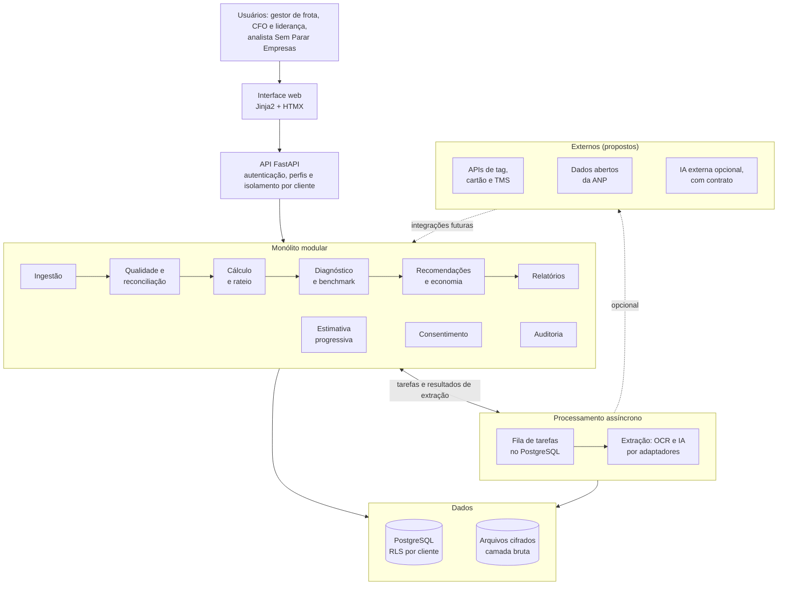
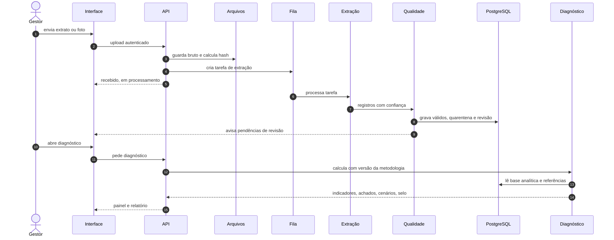

# Arquitetura técnica

Arquitetura **proposta** para as Sprints 2 a 4. Nada aqui está implantado; integrações externas são propostas, não existentes.

## 1. Requisitos que orientam a arquitetura

| Código | Requisito não funcional | Consequência |
|---|---|---|
| RNF-01 | Isolamento total entre clientes | `empresa_id` em todas as tabelas, segurança em nível de linha no banco, testes de vazamento |
| RNF-02 | Rastreabilidade e reprodutibilidade | Camada bruta imutável; versão da metodologia em todo diagnóstico; cálculo determinístico |
| RNF-03 | Extração assíncrona | OCR e IA podem levar minutos; a interface não pode travar |
| RNF-04 | Segurança e LGPD | Criptografia, auditoria, perfis de acesso, retenção ([segurança](seguranca-lgpd.md)) |
| RNF-05 | Custo e complexidade proporcionais a um MVP acadêmico | Poucos componentes; nada de serviço distribuído sem necessidade |
| RNF-06 | Desempenho | Meta: diagnóstico de 100 veículos com 12 meses em até 10 segundos; a implementação de referência carrega, valida e calcula IND-01 a IND-05 das três frotas sintéticas (21.656 despesas) em cerca de 0,9 s, e o script completo de exemplos, com simulações e backtest, em cerca de 4 s (medido em 9 out. 2026 no ambiente de desenvolvimento, 4 vCPU; não é teste de carga) |
| RNF-07 | Evolução incremental | Módulos com fronteiras claras, que possam virar serviços se a escala exigir |
| RNF-08 | Observabilidade | Logs estruturados, métricas de filas e de extração, rastreio de erros |

## 2. Alternativas avaliadas

| Decisão | Alternativas | Escolha | Por quê |
|---|---|---|---|
| Estilo | Microsserviços; funções sem servidor; **monólito modular com processo de tarefas** | Monólito modular | Equipe de 4 ou 5 pessoas e 8 meses; um único implantável reduz custo operacional; as fronteiras de módulo preservam a evolução |
| Backend | Django e DRF (administração, autenticação e ORM prontos); NestJS (TypeScript); **FastAPI** | FastAPI com SQLAlchemy, Alembic e Pydantic | Mesma linguagem dos cálculos (Python); contratos tipados que servem também como esquema de extração por IA; documentação OpenAPI automática. Contrapartida: autenticação e telas de administração precisam de bibliotecas maduras, não de código próprio |
| Front-end | Aplicação React; Streamlit; **páginas renderizadas no servidor com Jinja2 e HTMX** | Jinja2 e HTMX no MVP | Equipe com perfil Python; uma base de código; os mesmos modelos de página geram o relatório em PDF. Streamlit é bom para protótipo, mas fraco em controle de acesso e leiaute; React é a evolução se a interação crescer |
| Banco | SQLite; MongoDB; **PostgreSQL** | PostgreSQL | Integridade referencial para dados financeiros; segurança em nível de linha (RLS) para isolar clientes; JSONB para evidências e saídas de extração |
| Cálculo analítico | Polars; DuckDB; **pandas** | pandas no MVP | Implementação de referência já em pandas ([`src/calculos.py`](../src/calculos.py)); DuckDB e Polars ficam como otimização se a escala exigir |
| Fila de tarefas | Celery com RabbitMQ; RQ com Redis; **tabela de fila no PostgreSQL (`SELECT ... FOR UPDATE SKIP LOCKED`)** | Fila no PostgreSQL | Um componente a menos; volume do MVP baixo; troca por fila dedicada se necessário |
| Extração (OCR e IA) | Tesseract; serviço de nuvem; modelo multimodal | **Decisão na Sprint 3**, por comparação na mesma amostra | Interface de adaptador permite trocar o fornecedor sem mudar o resto ([estratégia de IA](estrategia-ia.md#ia-01-extração-documental)) |
| Arquivos | Banco de dados; **armazenamento de objetos compatível com S3** | Objetos cifrados | Arquivos fora do banco; URLs temporárias; camada bruta imutável |
| Relatórios | Biblioteca de PDF programática; **HTML convertido em PDF** | HTML → PDF | Reaproveita os modelos de página e a identidade visual |
| Hospedagem | Máquina virtual; **contêineres em provedor de nuvem** | Contêineres | Mesmo ambiente em desenvolvimento e produção; fornecedor definido com a FIAP ou a Sem Parar Empresas **[Pendência]** |

A combinação Python, FastAPI, pandas e PostgreSQL foi escolhida por **adequação ao problema e à equipe**, não por ser obrigatória. O ponto mais fraco dela é a interface, por isso a camada web fica isolada da API.

## 3. Visão geral

Este é o **diagrama de arquitetura geral**. Linhas tracejadas indicam integrações propostas.

## 4. Módulos

| Módulo | Responsabilidade | Entrada → saída | User Stories | Sprint |
|---|---|---|---|---|
| Interface web | Telas do gestor, do CFO e da Sem Parar Empresas; fila de revisão | Ações do usuário → chamadas à API | Todas | S2 a S4 |
| API | Autenticação, autorização por perfil e cliente, validação de entrada, OpenAPI | HTTP → casos de uso | Todas | S2 |
| Ingestão | Recepção, hash, detecção de tipo, antivírus, armazenamento bruto, enfileiramento | Arquivo → origem registrada e tarefa | GF-01 | S2 |
| Extração | Leitura estruturada, OCR e IA por adaptadores, com confiança por campo | Arquivo → registros candidatos | GF-01 | S2, S3 |
| Qualidade | Padronização, regras R-*, reconciliação, quarentena, revisão humana | Candidatos → base analítica | GF-01, GF-02 | S2 |
| Cálculo | Rateio por competência, indicadores IND-01 a IND-12, versão da metodologia | Base analítica → indicadores | GF-02, CF-03 | S2 |
| Estimativa | Níveis N0 a N3, Monte Carlo, perguntas por valor da informação | Cadastro e respostas → faixa e perguntas | GF-09, GF-10, SP-04 | S2, S3 |
| Benchmark | Hierarquia de referências e regras BEN | Indicadores → comparações | GF-04, SP-03 | S3 |
| Diagnóstico | Desvios, decomposição, estágios de evidência, confiabilidade | Indicadores e referências → achados | GF-03, CF-04 | S3 |
| Recomendações | Catálogo REC, economia por cenário, priorização, associação ao portfólio | Achados → plano de ação | GF-05 a GF-07, SP-01 | S3 |
| Relatórios | Relatório executivo em PDF | Diagnóstico → documento | CF-01 | S4 |
| Monitoramento | Atualizações, lembretes, economia realizada, recalibração | Novos dados → comparação e medição | GF-08, SP-05 | S4 |
| Consentimento | Preferências por finalidade, base legal, histórico e revogação | Manifestação → registro | SP-02, SP-06 | S2, S4 |
| Auditoria | Registro imutável de acessos, alterações, exportações e consultas comerciais | Eventos → trilha | Transversal | S2 |

## 5. Do envio ao relatório

## 6. Decisões registradas

| ADR | Decisão | Consequência aceita |
|---|---|---|
| ADR-01 | Monólito modular com processo de tarefas | Escalar por réplicas do mesmo serviço; fronteiras de módulo vigiadas em revisão de código |
| ADR-02 | Cálculo financeiro determinístico, versionado e testado; IA nunca produz número final | Explicações por IA exigem verificação numérica ([estratégia de IA](estrategia-ia.md#3-verificação-numérica-de-textos-gerados)) |
| ADR-03 | Camada bruta imutável e base analítica derivada | Reprocessamento possível a qualquer momento; mais armazenamento |
| ADR-04 | Isolamento por RLS no PostgreSQL, além do filtro na aplicação | Testes automatizados de vazamento entre clientes são obrigatórios |
| ADR-05 | Extração por adaptadores, com escolha baseada em avaliação | Uma camada a mais de abstração |
| ADR-06 | Competência como visão padrão; caixa como visão alternativa | Regras de vigência precisam ser mantidas por tipo de custo |
| ADR-07 | Cenários em escada de evidência | Valores do cenário-base menores do que somar tudo, e mais defensáveis |
| ADR-08 | Associação ao portfólio somente por regra | Catálogo revisado com a Sem Parar Empresas |
| ADR-09 | Pseudonimização na base analítica (placa, condutor, auto, apólice) | Chave de pseudonimização por cliente, guardada em cofre de segredos |

## 7. Os cinco diagramas pedidos

| Diagrama | Onde está |
|---|---|
| Arquitetura geral | Seção 3 deste documento |
| Fluxo de dados | [Ingestão e qualidade, seção 1](ingestao-qualidade.md#1-fluxo-de-dados) |
| Entidades (modelo conceitual) | [Modelagem de dados, seção 2](modelagem-dados.md#2-modelo-conceitual) |
| Diagnóstico progressivo | [Diagnóstico, seção 7](diagnostico.md#7-fluxo-do-diagnóstico-progressivo) |
| Geração de recomendações | [Economia e recomendações, seção 8](economia-recomendacoes.md#8-fluxo-de-geração-de-recomendações) |

Todos estão em Mermaid, versionados com o texto e verificados pelo parser oficial do Mermaid ([validação](validacao.md)). Versões em SVG ficam em [`assets/diagramas/`](../assets/diagramas/).

## 8. Ambientes e entrega

- **Desenvolvimento:** contêineres com aplicação, PostgreSQL e armazenamento de objetos local; massa sintética carregada por script.
- **Integração contínua:** formatação, análise estática, testes unitários das regras e indicadores, testes de igualdade dos totais, testes de vazamento entre clientes, validação dos dados contra o dicionário e reprocessamento dos exemplos da documentação.
- **Homologação e piloto:** dados de clientes só com contrato e autorização; carga inicial com dados sintéticos.
- **Segredos:** em cofre do provedor, nunca no repositório ([segurança](seguranca-lgpd.md#2-requisitos-de-segurança)).

## 9. Integrações propostas (não existentes)

| Integração | Uso | Situação |
|---|---|---|
| Extratos de tag e Vale-Pedágio | Importação automática de passagens | Proposta; depende de API ou leiaute fornecido pela Sem Parar Empresas |
| Cartão de combustível e gestão de abastecimento | Transações com litros e preço | Proposta |
| NF-e (XML) | Notas de combustível e manutenção com campos estruturados | Proposta; importação de arquivo XML enviado pelo cliente |
| Dados abertos da ANP | Referência de preço por município e semana | Proposta; dado público |
| TMS e telemetria | Viagens, km e eixos suspensos | Proposta; depende do cliente |

## 10. Riscos técnicos

| Risco | Impacto | Mitigação |
|---|---|---|
| Extração abaixo da meta em fotos reais | Muito trabalho de revisão | Comparação de alternativas na Sprint 3; incentivo a extratos estruturados; revisão em lote |
| Leiautes de extrato mudam sem aviso | Importações quebradas | Conectores versionados com testes de contrato; alerta de leiaute desconhecido |
| Vazamento entre clientes | Grave (confidencialidade e LGPD) | RLS mais filtro na aplicação; testes automatizados; auditoria |
| Desempenho com frotas grandes | Diagnóstico lento | Pré-agregação por veículo·mês; DuckDB ou Polars se necessário |
| Dependência de serviço externo de IA | Custo, indisponibilidade e privacidade | Adaptadores; alternativa local (Tesseract); contrato sem retenção |
