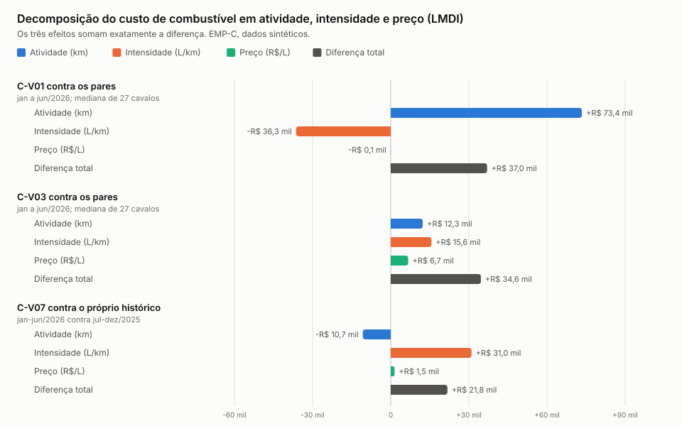

# Benchmarks e comparabilidade

Especifica a capacidade C3 (Compare) e atende a US-GF-04 e US-SP-03. O projeto **não tem nem presume** benchmarks proprietários da Sem Parar Empresas: a hierarquia começa pelo que o próprio cliente fornece e só avança quando há dados, autorização e equivalência.

## 1. O que torna duas operações comparáveis

| Dimensão | Por que importa | Como entra na comparação |
|---|---|---|
| Categoria do veículo | Consumo, manutenção e pedágio dependem de porte e eixos | Obrigatória: só se compara dentro da categoria |
| Modalidade operacional | Urbano, regional e longa distância têm perfis de custo diferentes | Obrigatória para grupos entre frotas |
| Quilometragem | Custos fixos diluem com uso; rendimento varia com o regime | Faixas de km/mês; indicadores por km |
| Região (UF) | Preço de combustível, tributos e malha pedagiada | Obrigatória para preço e tributos |
| Período | Preços, sazonalidade e regras mudam | Mesma janela; histórico próprio com linha de base explícita |
| Perfil de uso | Carregado × vazio, lotação × fracionada | Separação por tipo de viagem quando há dados de viagem |
| Regime de posse | Na locação, manutenção e seguro vêm embutidos | Locados fora das comparações dessas categorias |
| Particularidades | Refrigeração, carga perigosa, operação noturna | Registradas como atributo; grupos separados quando relevantes |

## 2. Hierarquia de referências

| Nível | Referência | Requisito mínimo | Força | Limitação | Situação |
|---|---|---|---|---|---|
| 1 | **Histórico da própria operação** (mesmo veículo ou frota) | 3 meses de linha de base; 6 para CUSUM | Melhor para detectar mudança; elimina diferenças de perfil | Não diz se a linha de base já era ineficiente | Demonstrado (CUSUM, LMDI temporal) |
| 2 | **Pares da mesma frota** | 5 veículos da mesma categoria e modalidade, cada um com 1.000 km ou mais no período (BEN-01) | Mesmo gestor, rotas e preços parecidos | Pares podem compartilhar a mesma ineficiência | Demonstrado (z modificado, LMDI entre pares) |
| 3 | **Grupos operacionais equivalentes entre clientes** | 10 empresas ou mais; nenhuma com mais de 25% dos veículos do grupo; uso agregado autorizado (BEN-06) | Responde "como estou em relação ao mercado" | Exige base de clientes, autorização e governança | Especificado; depende de piloto |
| 4 | **Referências externas verificadas** | Fonte, data, metodologia e escopo registrados (BEN-07) | Independente do cliente | Escopo raramente igual ao do indicador | Especificado; ver lista abaixo |
| 5 | **Cenários hipotéticos** | Rótulo "hipotético" visível | Permite simular "e se" | Não é referência de mercado | Usado só em simulação de cenários |

Referências externas candidatas (detalhes e verificação em [referências](referencias.md)):

| Fonte | Uso | Limitação |
|---|---|---|
| ANP, Levantamento de Preços de Combustíveis (série por município, UF e semana) | Referência de preço pago (IND-08) | Cobertura de municípios reduzida a partir de 2025; preço médio de revenda, não o preço negociado |
| CTB, art. 258 (valores das multas) e art. 284 (descontos) | Valores de multa e descontos | Fatores multiplicadores específicos de algumas infrações |
| Legislação estadual de IPVA | Conferência de tributos | Varia por UF e categoria; não foi consultada nesta Sprint, e as alíquotas da simulação são hipóteses |
| ANTT, pisos mínimos de frete (Lei nº 13.703/2018) | Ordem de grandeza do custo por km de veículos de carga, como contexto | Inclui itens fora do escopo da calculadora (remuneração, depreciação) e é piso de frete, não custo observado; uso apenas contextual |

## 3. Quando não comparar

| Regra | Condição | Comportamento |
|---|---|---|
| BEN-01 | Menos de 5 pares válidos na categoria e modalidade | Comparação entre pares não exibida; usa histórico próprio |
| BEN-02 | Período desalinhado (pares) ou linha de base com menos de 3 meses (histórico) | Não compara; informa quanto histórico falta |
| BEN-03 | Veículo locado em comparação de manutenção, seguro ou tributos | Excluído do grupo (cenário G30) |
| BEN-04 | Evento extraordinário marcado (sinistro, revisão completa programada) | Excluído da linha de base de desvios (cenários G08 e G25) |
| BEN-05 | Comparar custo de combustível sem separar consumo e preço | Proibido: sempre decompor (seção 4) |
| BEN-06 | Grupo entre clientes com menos de 10 empresas ou com empresa acima de 25% dos veículos | Grupo suprimido ou agregado ao nível superior |
| BEN-07 | Referência externa sem fonte, data ou metodologia | Não usada |
| BEN-08 | Dimensão de confiabilidade relevante abaixo de 40 | Comparação não exibida; pergunta guiada para completar os dados |

Quando a comparação não é feita, o produto **explica por quê**, por exemplo: "Ainda não comparamos seus utilitários com outros: são só 3 veículos e o mínimo é 5. Comparamos com o histórico de cada um."

## 4. Decomposição: atividade, intensidade e preço

O custo de combustível de um veículo é o produto de três fatores:

$$C = \underbrace{A}_{\text{km rodados}} \times \underbrace{I}_{\text{litros por km}} \times \underbrace{P}_{\text{reais por litro}}$$

A diferença em relação a uma referência é decomposta pelo método LMDI-I aditivo (Ang, 2005), que reparte a diferença **sem resíduo**:

$$C_v - C_{ref} = L\ln\frac{A_v}{A_{ref}} + L\ln\frac{I_v}{I_{ref}} + L\ln\frac{P_v}{P_{ref}}, \qquad L = \frac{C_v - C_{ref}}{\ln C_v - \ln C_{ref}}$$

**Por que isso importa:**

1. **Volume não é desperdício.** O efeito atividade (rodar mais) não é ineficiência e não entra na economia.
2. **Preço e consumo têm alavancas diferentes.** Preço leva a política de abastecimento (REC-04); intensidade leva a mecânica e condução (REC-05).
3. **Não há dupla contagem.** Como os efeitos somam exatamente a diferença, a mesma parcela do custo nunca é atribuída a duas oportunidades.

Exemplos na EMP-C, jan a jun/2026 ([anexo](anexos/exemplos-calculados.md#decomposição-lmdi-do-custo-de-combustível)). Referência entre pares: veículo típico formado pelas medianas de km, L/km e R$/L de 27 cavalos.

| Caso | Diferença | Atividade | Intensidade | Preço | Leitura |
|---|---|---|---|---|---|
| C-V01 contra os pares | R$ 36.993,78 | R$ 73.378,83 | -R$ 36.319,41 | -R$ 65,64 | Custa mais porque roda muito mais; consome **menos** por km. Não é ineficiência (cenário G26) |
| C-V03 contra os pares | R$ 34.617,41 | R$ 12.292,74 | R$ 15.635,50 | R$ 6.689,17 | Paga mais caro (R$ 6,38 contra R$ 6,15 por litro) e consome mais; o preço é alavanca de abastecimento |
| C-V07 contra o próprio histórico (jul-dez/2025) | R$ 21.766,07 | -R$ 10.726,06 | R$ 31.011,88 | R$ 1.480,24 | Rodou menos, mas gastou mais: a intensidade (queda de 2,34 para 2,02 km/L) explica a diferença |

A intensidade de C-V03 em relação aos pares mostra o limite da comparação entre veículos: parte dela pode ser característica do próprio veículo, e não desperdício. Por isso a hipótese de consumo usa o **histórico do próprio veículo**, enquanto a comparação entre pares contextualiza.

## 5. Como os benchmarks melhoram com o uso (US-SP-03)

1. **Autorização.** Só entram diagnósticos de clientes que autorizaram o uso agregado ([segurança e LGPD](seguranca-lgpd.md#4-finalidades-comerciais-leads-e-benchmarks)).
2. **Agregação mínima.** Indicadores por veículo·mês, agregados por categoria, modalidade, UF e período; publicação só com BEN-06 satisfeita.
3. **Recalibração das premissas.** Frequências, severidades e faixas usadas na estimativa progressiva passam a vir dos grupos, versionadas.
4. **Prova de ganho.** Cada recalibração só entra em produção se melhorar o backtest (cobertura perto de 80% e erros distribuídos entre as duas caudas). Na massa sintética, a calibração com histórico reduziu o erro mediano da faixa de manutenção de 24,1% para 8,8% ([diagnóstico](diagnostico.md#5-estimativa-progressiva-e-perguntas-guiadas)).
5. **Transparência.** O usuário vê a versão da referência e quantas empresas e veículos ela representa.

## 6. Como a comparação aparece para o usuário

Toda comparação exibe tipo de referência, tamanho (veículos e empresas), período e selo de confiança. Exemplo de texto gerado por modelo determinístico:

> "Seu cavalo C-V07 fez 2,02 km/L de janeiro a junho, contra 2,34 km/L no semestre anterior (referência: histórico do próprio veículo, 6 meses). A queda começou em janeiro e se manteve. Isso custou cerca de R$ 27,8 mil em combustível no semestre. Confiança: moderada (a causa ainda não foi confirmada)."
