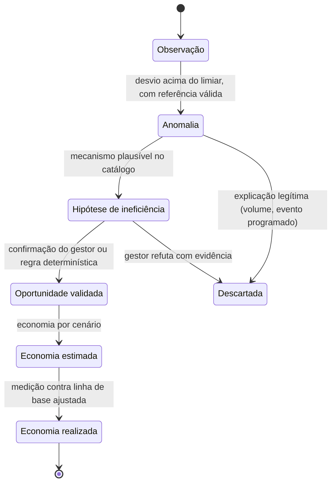
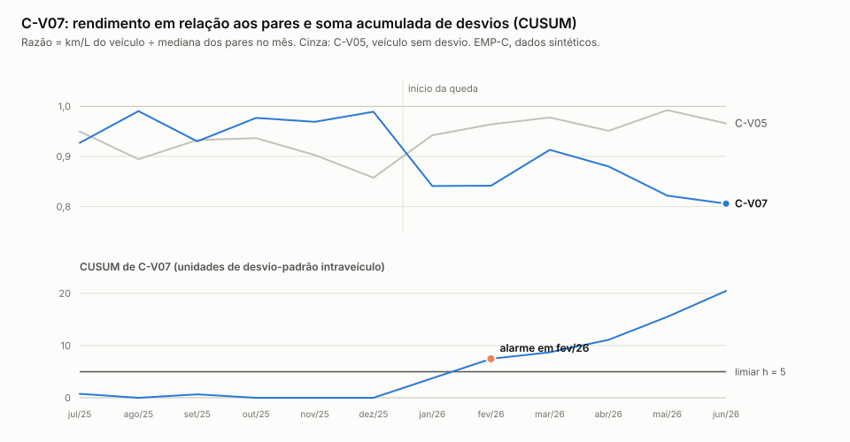
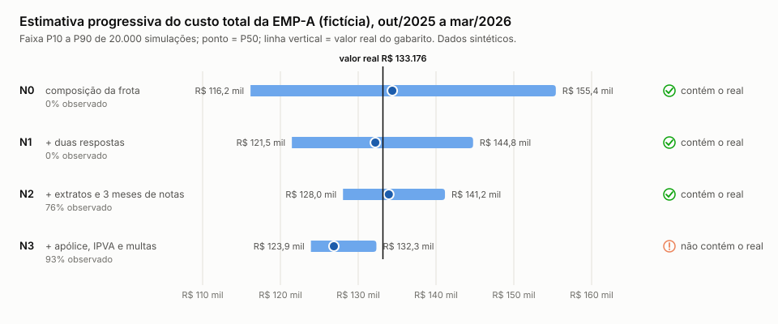
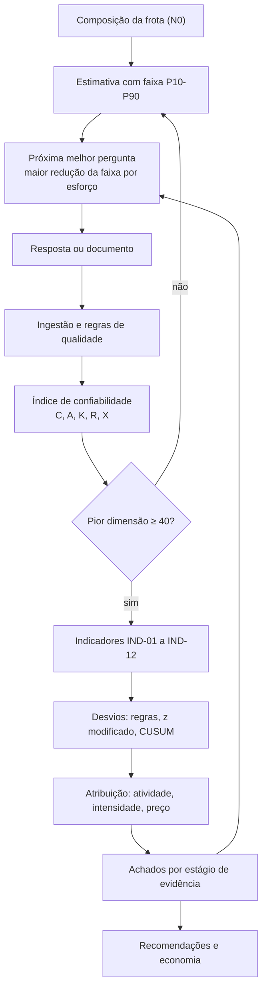

# Inteligência de diagnóstico

Especifica as capacidades C2 (Diagnose) e parte de C1 (estimativa progressiva). Todos os exemplos numéricos vêm de [`docs/anexos/exemplos-calculados.md`](anexos/exemplos-calculados.md), gerado por script a partir da massa sintética: os números são fictícios, mas a conta é real e reproduzível.

## 1. Princípios

1. **Cálculo determinístico e versionado.** Indicadores, estimativas e economia são calculados por código com parâmetros versionados. Modelos de linguagem não produzem números finais ([estratégia de IA](estrategia-ia.md)).
2. **Normalizar antes de comparar.** Custo absoluto não indica eficiência; comparações usam R$/km, R$/veículo·mês, km/L e R$/L.
3. **Correlação não é causa.** Um desvio indica onde olhar. A causa só é aceita com confirmação do gestor ou por regra determinística, como a multa NIC, que por definição decorre de não indicar o condutor.
4. **Custo alto não é desperdício.** Um veículo que roda 25% a mais custa mais. A decomposição em atividade, intensidade e preço ([benchmarks](benchmarks.md#4-decomposição-atividade-intensidade-e-preço)) separa os efeitos.
5. **Confiança por conclusão.** Cada achado tem a confiança dos dados que usou, não a média da base inteira.

## 2. Da observação à economia realizada

| Estágio | Definição | Exemplo na massa sintética | Quem decide |
|---|---|---|---|
| Observação | Fato calculado a partir dos dados | C-V07 fez 2,02 km/L em jan-jun/2026 | Sistema |
| Anomalia | Desvio acima do limiar em relação a uma referência válida | CUSUM de C-V07 passou do limiar em fev/2026 | Sistema |
| Hipótese de ineficiência | Anomalia com mecanismo plausível, ainda não confirmado | Queda de rendimento por problema mecânico ou de condução | Sistema propõe; gestor avalia |
| Oportunidade validada | Hipótese confirmada, ou fato que por regra já é ineficiência | Multa NIC; eixo suspenso cobrado em retorno vazio | Gestor ou regra |
| Economia estimada | Valor em R$ por cenário, com premissas | OP-C1, R$ 64.848 líquidos por ano no cenário-base | Sistema, com premissas visíveis |
| Economia realizada | Diferença medida entre a linha de base ajustada e o custo após a ação | Medida a partir da Sprint 4 | Sistema, com protocolo de medição |

A economia realizada segue a lógica de medição e verificação usada em eficiência energética (IPMVP, da EVO): a economia não se mede diretamente; ela é a diferença entre o que se teria gastado sem a ação, com a linha de base ajustada às condições do período, e o que se gastou ([referências](referencias.md)).

## 3. Indicadores

Notação: `v` veículo, `m` mês de competência, `c` categoria de custo. "Custo" é sempre custo próprio por competência, depois da deduplicação e sem valores em quarentena.

### IND-01 Custo total da operação (CTO)

| Atributo | Conteúdo |
|---|---|
| Definição | Soma dos custos próprios do período, por competência |
| Fórmula | `CTO = Σ custo(v, m, c)` para todos os veículos, meses do período e categorias, incluindo custos de frota |
| Unidade | R$ no período |
| Variáveis | `valor_brl`, `competencia_inicio`, `competencia_fim`, `natureza_custo` |
| Pré-condições | Período definido; deduplicação concluída |
| Denominador nulo | Não há denominador |
| Distorções | Lacunas reduzem o valor; categorias ausentes devem aparecer como estimadas, nunca como zero |
| Interpretação | Quanto a operação realmente custa; base para todos os demais indicadores |
| Exemplo | EMP-B, jul/2025 a jun/2026: **R$ 2.334.087,68** |
| Papel | Resposta direta a US-GF-02 e US-CF-03 |

### IND-02 Custo por veículo·mês

| Atributo | Conteúdo |
|---|---|
| Definição | Custo médio de manter um veículo ativo durante um mês |
| Fórmula | `CPV = CTO / Σ veículos ativos em cada mês` |
| Unidade | R$/veículo·mês |
| Variáveis | CTO; veículos com registro de uso no mês |
| Pré-condições | Cadastro de veículos com datas de entrada e saída |
| Denominador nulo | Sem veículos ativos: indicador não calculado |
| Distorções | Frota com veículos de categorias muito diferentes; usar por categoria |
| Interpretação | Útil para orçamento e para comparar o mesmo tipo de operação |
| Exemplo | EMP-B: R$ 2.334.087,68 / 360 veículos·mês = **R$ 6.483,58** |
| Papel | Ordem de grandeza para o CFO; entrada da estimativa N0 |

### IND-03 Custo por quilômetro

| Atributo | Conteúdo |
|---|---|
| Definição | Custo por km rodado, só nos veículos·mês com km observado |
| Fórmula | `CPK = Σ custo(v, m) / Σ km(v, m)`, somando apenas os pares (v, m) com km disponível; custos de frota rateados por veículo·mês |
| Unidade | R$/km |
| Variáveis | custo por veículo e mês; `km_rodados` |
| Pré-condições | Cobertura de km informada junto com o indicador |
| Denominador nulo | Sem km: indicador não calculado e pergunta sobre odômetro (status NAO_DISPONIVEL) |
| Distorções | Cobertura parcial de km vicia o resultado se os veículos sem km forem diferentes; custos fixos pesam mais em veículos pouco usados |
| Interpretação | Principal indicador de eficiência para comparar veículos da mesma categoria |
| Exemplo | EMP-B: **R$ 1,974/km**, cobertura de 99,2%. EMP-A: R$ 1,491/km com cobertura de apenas 62,5%, que por isso é exibido com alerta |
| Papel | Base de comparação (US-GF-04) e de detecção de desvios |

### IND-04 Participação por categoria

| Atributo | Conteúdo |
|---|---|
| Definição | Peso de cada categoria no custo total |
| Fórmula | `participação(c) = Σ custo(c) / CTO` |
| Unidade | % |
| Variáveis | custo por categoria; CTO |
| Pré-condições | CTO > 0 |
| Denominador nulo | CTO = 0: não calculado |
| Distorções | Categoria ausente aparece com 0%; o produto mostra a estimativa separadamente |
| Interpretação | Onde o dinheiro está; orienta qual alavanca tem maior potencial |
| Exemplo | EMP-B: combustível 57,9%, manutenção 20,7%, seguro 8,5%, pedágio 8,3%, tributos 3,4%, outros 1,0%, multas 0,3% |
| Papel | Mapa de custos do relatório executivo |

### IND-05 Variação temporal

| Atributo | Conteúdo |
|---|---|
| Definição | Mudança do custo mensal em relação ao mês anterior e à mediana dos três meses anteriores |
| Fórmula | `Δmês = C(m) / C(m-1) - 1`; `Δref = C(m) / mediana(C(m-3..m-1)) - 1` |
| Unidade | % |
| Variáveis | custo mensal por competência |
| Pré-condições | Ao menos 2 meses para Δmês e 4 para Δref |
| Denominador nulo | Mês anterior sem custo: não calculado |
| Distorções | Sazonalidade e dias úteis; pagamentos à vista (por isso a competência) |
| Interpretação | Sinal de mudança, não de ineficiência; sempre ler com o volume (km) |
| Exemplo | EMP-B, mai/2026: +16,9% sobre abr/2026. Em abril, caixa de R$ 369.725,51 contra competência de R$ 182.167,09 (seguro anual pago à vista) |
| Papel | Acompanhamento mensal (US-GF-08, US-CF-03) |

### IND-06 Manutenção

| Atributo | Conteúdo |
|---|---|
| Definição | Custo de manutenção por km e participação da corretiva no gasto preventivo mais corretivo |
| Fórmula | `manut/km = Σ manutenção / Σ km`; `% corretiva = corretiva / (corretiva + preventiva)` |
| Unidade | R$/km e % |
| Variáveis | `manutencoes.tipo`, valor, km |
| Pré-condições | 6 meses ou mais (custo irregular); veículos próprios (locados excluídos, regra BEN-03) |
| Denominador nulo | Sem km ou sem manutenção: não calculado |
| Distorções | Custo irregular (pneus, revisões completas); sinistros precisam ser marcados e excluídos |
| Interpretação | Corretiva alta indica preventiva insuficiente ou veículo no fim da vida útil |
| Exemplo | B-V12 (2013): 83,3% de corretiva e R$ 0,5098/km, contra mediana de 39,6% e R$ 0,1166/km nos caminhões toco de 2017 a 2022. B-V14, do mesmo ano, não apresenta o padrão: idade é fator de risco, não diagnóstico |
| Papel | Origem da hipótese REC-10 |

### IND-07 Rendimento de combustível

| Atributo | Conteúdo |
|---|---|
| Definição | Quilômetros por litro no mês, por veículo, e razão em relação à mediana dos pares no mesmo mês |
| Fórmula | `km/L(v, m) = km(v, m) / Σ litros(v, m)`; `razão(v, m) = km/L(v, m) / mediana dos pares (m)` |
| Unidade | km/L e razão adimensional |
| Variáveis | litros (com IMP-01 quando necessário), km do mês, categoria |
| Pré-condições | km disponível; registros fora das regras R-ABS-TANQUE, R-CONC-VALOR, R-COMB-INCOMP e R-PRECO-FAIXA |
| Denominador nulo | Sem litros: não calculado |
| Distorções | Abastecimento ausente infla o rendimento do registro seguinte quando se usa o método tanque cheio por abastecimento; por isso o cálculo é mensal e agregado |
| Interpretação | Queda persistente da razão indica problema mecânico, de condução ou de rota |
| Exemplo | C-V07: mediana de 2,35 km/L em jul-dez/2025 e 2,02 km/L em jan-jun/2026 |
| Papel | Entrada do CUSUM (seção 4) e do efeito intensidade (LMDI) |

### IND-08 Preço pago em relação à referência

| Atributo | Conteúdo |
|---|---|
| Definição | Quanto se pagou acima da referência de preço do mesmo combustível no mesmo mês |
| Fórmula | `prêmio = Σ litros × (preço - referência)` nos abastecimentos com `preço > referência × 1,02` |
| Unidade | R$ e R$/L |
| Variáveis | preço por litro, combustível, mês; referência = mediana da própria frota (versão inicial) ou série da ANP por município e semana (evolução) |
| Pré-condições | Ao menos 30 abastecimentos do combustível no mês para a referência interna |
| Denominador nulo | Não se aplica |
| Distorções | Postos isolados em rota sem alternativa; a tolerância de 2% evita contar a dispersão normal |
| Interpretação | Mostra escolha de posto e política de abastecimento; separa preço de consumo |
| Exemplo | C-V27: **R$ 17.112,86** em 12 meses (R$ 0,2988/L), com 58,3% dos abastecimentos acima da referência |
| Papel | Origem de REC-04 |

### IND-09 Multas

| Atributo | Conteúdo |
|---|---|
| Definição | Incidência de infrações e custos evitáveis associados |
| Fórmula | `multas/10 mil km = nº de multas originais / km × 10.000`; custo NIC; desconto perdido = `0,20 × valor das multas pagas após o vencimento` |
| Unidade | multas/10 mil km; R$ |
| Variáveis | `multas.tipo_multa`, gravidade, datas, desconto; km |
| Pré-condições | Relação de multas do período; ausência de registro só vale como zero se o gestor confirmar |
| Denominador nulo | Sem km: mostrar só por veículo·mês |
| Distorções | Multas chegam meses depois da infração; competência é a data da infração |
| Interpretação | NIC e desconto perdido são custos de processo, evitáveis; incidência alta indica comportamento ou rota |
| Exemplo | EMP-B: 0,29 multa por 10 mil km; 6 multas NIC (**R$ 2.033,43**); 7 multas sem desconto (R$ 206,53 perdidos) |
| Papel | Origem de REC-01 a REC-03 |

### IND-10 Pedágio

| Atributo | Conteúdo |
|---|---|
| Definição | Custo próprio de pedágio por km, por meio de pagamento, com cobranças indevidas identificadas |
| Fórmula | `pedágio/km = Σ pedágio próprio / Σ km`; participação por meio (tag, Vale-Pedágio, manual) |
| Unidade | R$/km; % |
| Variáveis | `pedagios`, `viagens`, `natureza_custo` |
| Pré-condições | Extratos do período; viagens, quando houver |
| Denominador nulo | Sem km: mostrar total |
| Distorções | Pedágio custeado pelo contratante (Vale-Pedágio) não é custo próprio; meses sem extrato |
| Interpretação | Exposição a rodovias pedagiadas; a eficiência está em não pagar o indevido |
| Exemplo | EMP-C: R$ 0,161/km de pedágio próprio; R$ 876.819,54 custeados por terceiros, fora do custo; 176 retornos vazios com eixo suspenso cobrado (R$ 30.662,59) |
| Papel | Origem de REC-07 a REC-09 e REC-13 |

### IND-11 Utilização

| Atributo | Conteúdo |
|---|---|
| Definição | Quilometragem média mensal do veículo em relação à mediana da categoria na frota |
| Fórmula | `razão = km médio mensal(v) / mediana(km médio mensal dos pares)` |
| Unidade | km/mês e % |
| Variáveis | km mensal, categoria |
| Pré-condições | Ao menos 3 meses de km |
| Denominador nulo | Mediana zero: não calculado |
| Distorções | Veículo reserva ou de função específica tem uso baixo por desenho |
| Interpretação | Abaixo de 40% da mediana (limiar inicial, a calibrar) indica possível excesso de frota; os custos fixos continuam correndo |
| Exemplo | B-V28: 319 km/mês, 15,1% da mediana de 2.117 km/mês; custo fixo de R$ 4.569,32/ano |
| Papel | Origem de REC-11 (sempre hipótese até validação operacional) |

### IND-12 Desvio robusto em relação aos pares

| Atributo | Conteúdo |
|---|---|
| Definição | Distância de um veículo à mediana dos pares, em unidades robustas |
| Fórmula | `z modificado = 0,6745 × (x - mediana) / MAD`, com `MAD = mediana(\|x - mediana\|)`; alerta com módulo acima de 3,5 (Iglewicz e Hoaglin, 1993) |
| Unidade | Adimensional |
| Variáveis | qualquer indicador normalizado (R$/km, km/L, prêmio por litro) |
| Pré-condições | Ao menos 5 pares (BEN-01) |
| Denominador nulo | MAD = 0 (mais da metade dos valores iguais): usar intervalo interquartil ou não calcular |
| Distorções | Pares heterogêneos inflam a MAD e escondem desvios; ver seção 4 |
| Interpretação | Mediana e MAD não são puxadas pelos próprios outliers, o que evita o mascaramento que o z comum sofre |
| Exemplo | Prêmio por litro: z de 8,71 (C-V27), 7,36 (C-V03) e 4,01 (C-V02). Os cinco veículos do cenário G13 e um veículo não injetado com hábito real de postos mais caros passam do limiar |
| Papel | Ranqueamento de desvios entre pares |

## 4. Detecção de desvios

| Método | Para quê | Parâmetros iniciais | Limitação |
|---|---|---|---|
| Regras determinísticas | Fatos que por definição são problema (NIC, eixo suspenso cobrado, cobrança duplicada) | Ver regras R-* e REC-* | Só encontra o que foi previsto |
| z modificado entre pares | Veículo diferente dos pares no mesmo período | limiar 3,5 | Pares heterogêneos (veículos com eficiência própria diferente) reduzem a sensibilidade |
| CUSUM unilateral sobre a razão km/L do veículo / mediana dos pares | Mudança persistente no próprio veículo | k = 0,5 e h = 5, em desvios-padrão intraveículo | Precisa de linha de base de 6 meses |
| Decomposição LMDI | Atribuir o desvio a atividade, intensidade ou preço | Sem parâmetros | Explica, não prova causa |

O CUSUM (Page, 1954) acumula desvios abaixo da linha de base:

$$S_t = \max\left(0,\; S_{t-1} + \frac{\mu_0 - x_t}{\sigma} - k\right),\qquad \text{alarme quando } S_t > h$$

em que `x_t` é a razão entre o rendimento do veículo e a mediana dos pares no mês, `μ0` a média dessa razão na linha de base e `σ` o desvio-padrão **dentro do veículo**. A escolha de `σ` fez diferença no teste: com a dispersão **entre** veículos (cada cavalo tem eficiência própria), o CUSUM só detectou 1 dos 3 veículos com queda. Com o desvio-padrão intraveículo (0,029), detectou os 3 (C-V07 e C-V15 em fev/2026, C-V22 em mar/2026), um a dois meses após o início da queda, sem alarme falso entre os 40 veículos. Dividir pela mediana dos pares remove efeitos comuns a toda a frota, como sazonalidade e preço.

Casos de **custo alto sem ineficiência** que os métodos não marcaram: C-V01 e C-V02 (volume, cenário G26), revisão completa programada de B-V05 (G08), franquia de sinistro (G25) e seguro pago à vista (G07).

## 5. Estimativa progressiva e perguntas guiadas

**Objetivo.** Atender US-GF-09 e US-SP-04: sempre mostrar uma estimativa do custo total, com faixa que diminui conforme chegam informações.

**Modelo.** Cada componente de custo é observado (valor fixo) ou estimado por simulação de Monte Carlo (20.000 sorteios):

- **Combustível, pedágio, tributos, seguro, multas, locação e outros:** distribuições triangulares (mínimo, moda, máximo) por veículo·mês, a partir de premissas documentadas em `PRIORI` ([`src/calculos.py`](../src/calculos.py)). As premissas por categoria são compartilhadas entre os veículos da categoria, o que é conservador.
- **Manutenção:** custo de eventos raros e caros, modelado como **frequência × severidade**. O número de eventos segue Poisson, com taxa por 10 mil km atualizada pelos eventos observados (conjugada Gamma-Poisson), e o custo de cada evento segue lognormal. Uma primeira versão, que repetia a média dos meses observados, subestimava a incerteza, porque três meses não mostram a irregularidade de pneus e revisões completas.
- **Faixa exibida:** P10 a P90. Não é probabilidade calibrada; é a faixa central da simulação sob as premissas declaradas.

**Resultado na EMP-A** (6 meses; valor real conhecido pelo gabarito: R$ 133.176,48):

| Nível | Informação | Faixa P10 a P90 | Largura | Parcela observada | Contém o real? |
|---|---|---|---|---|---|
| N0 | Composição da frota, segmento e UF | R$ 116.158 a R$ 155.401 | R$ 39.243 | 0% | sim |
| N1 | + km médio e gasto mensal com combustível | R$ 121.473 a R$ 144.767 | R$ 23.293 | 0% | sim |
| N2 | + extratos, locação e 3 meses de notas de oficina | R$ 128.046 a R$ 141.151 | R$ 13.106 | 76% | sim |
| N3 | + apólice, IPVA, licenciamento e multas | R$ 123.923 a R$ 132.339 | R$ 8.416 | 93% | **não** |

**Leitura honesta do N3.** Com seguro, tributos e multas conhecidos, sobra só a manutenção dos três meses sem nota, que concentraram eventos caros (o gabarito registra R$ 10.260,26). O valor real ficou acima do P90. Uma faixa P10-P90 bem calibrada erra, por definição, uma vez em cada cinco; um caso isolado não prova nem refuta a calibração. Por isso a avaliação é feita por cobertura em muitos ensaios (abaixo), e a terceira pergunta da lista é justamente enviar as notas que faltam.

**Próxima melhor pergunta (US-GF-10).** No estado atual (N2), cada pergunta é avaliada pela redução da largura da faixa dividida pelo esforço (1 = responder ou enviar um documento; 2 = reunir vários documentos). As comparações usam os mesmos sorteios, para que a diferença venha só da informação nova:

| Ordem | Pergunta | Esforço | Redução da largura |
|---|---|---|---|
| 1 | Enviar a apólice de seguro (ou informar o prêmio anual) | 1 | R$ 3.056 (23,5%) |
| 2 | Enviar comprovantes de IPVA e licenciamento | 1 | R$ 1.840 (14,1%) |
| 3 | Enviar as notas de oficina de out/2025, nov/2025 e mar/2026 | 2 | R$ 3.136 (24,1%) |
| 4 | Informar se houve multas e o valor pago | 1 | R$ 119 (0,9%) |

Na interface, a pergunta aparece com o ganho em linguagem simples: "Enviar a apólice reduz a incerteza da sua estimativa em cerca de R$ 3 mil".

**Teste de calibração (backtest).** Janelas de 6 meses dos utilitários da EMP-B: 3 meses observados, 3 mascarados, subconjuntos aleatórios de veículos.

| Ensaio | Cobertura P10-P90 | Acima do P90 | Abaixo do P10 | Erro mediano do P50 |
|---|---|---|---|---|
| Todas as janelas, premissa genérica (280 ensaios) | 76,1% | 23,2% | 0,7% | -40,8% |
| Janelas de 2026, premissa genérica (120) | 97,5% | 0,0% | 2,5% | 24,1% |
| Janelas de 2026, premissa calibrada em jul-dez/2025 (120) | 95,8% | 3,3% | 0,8% | 8,8% |

A cobertura total de 76,1% parece próxima dos 80% esperados, mas os erros estão quase todos acima do P90: é **viés** da premissa genérica, não boa calibração. Calibrar com histórico reduziu o erro mediano de 24,1% para 8,8% nas mesmas janelas. Os ensaios compartilham veículos e meses, portanto não são independentes, e o gerador e o estimador usam a mesma família de hipóteses. O resultado demonstra o **procedimento**; a evidência estatística virá do mesmo teste com dados reais (critério de aceite na Sprint 3).

## 6. Índice de confiabilidade

Cinco dimensões, inspiradas nas características de qualidade de dados da ISO/IEC 25012 (completude, consistência, atualidade e rastreabilidade), mais uma dimensão própria de contexto operacional. Cada uma vai de 0 a 100.

| Dimensão | Fórmula | Leitura |
|---|---|---|
| **C** Completude | custo observado / (custo observado + estimativa das lacunas) | Quanto do custo total vem de documento |
| **A** Atualidade | 100 até 45 dias desde o fim da última competência; cai linearmente até 0 aos 180 dias | Se o retrato ainda vale |
| **K** Consistência | 1 - (valor com pendência não resolvida × peso da regra) / valor total; peso 1,0 para quarentena, 0,5 para valor mantido com campo excluído, 0,1 para odômetro | Quanto do valor tem problema aberto |
| **R** Rastreabilidade | Σ valor × peso da evidência / Σ valor; peso 1,0 para extrato e documento estruturado, 0,8 para OCR, 0,7 para texto livre, 0,5 para digitação ou OCR abaixo de 0,80 | Quanto do valor pode ser auditado até o documento |
| **X** Contexto | média, por veículo, de três condições: categoria conhecida, km em 80% dos meses ou mais, modalidade definida | Se dá para normalizar e comparar |

**Selo:** Alta (pior dimensão ≥ 80), Moderada (≥ 60), Baixa (≥ 40) ou Insuficiente (< 40). O selo usa a **pior** dimensão, e não a média, porque uma média alta esconderia uma falha que invalida conclusões (por exemplo, dados excelentes, mas de seis meses atrás). Com selo Insuficiente, o produto mostra só a estimativa com faixa e as perguntas guiadas, sem achados em R$.

| Empresa | C | A | K | R | X | Selo |
|---|---|---|---|---|---|---|
| EMP-A | 75,6 | 58,5 | 96,9 | 97,9 | 87,5 | Baixa (atualidade: últimos dados de mar/2026 para análise em jul/2026) |
| EMP-B | 100,0 | 100,0 | 100,0 | 99,7 | 100,0 | Alta |
| EMP-C | 99,5 | 100,0 | 99,8 | 99,9 | 100,0 | Alta |

O índice **não é uma probabilidade**. É uma medida ordinal da qualidade da evidência, com pesos e limiares definidos pelo grupo, a calibrar com uso real. Cada achado recebe também a confiança da sua própria evidência (Alta, Moderada ou Baixa), usada na priorização ([economia](economia-recomendacoes.md#5-priorização-e-próximo-passo)).

## 7. Fluxo do diagnóstico progressivo

Este é o **diagrama do fluxo de diagnóstico progressivo** da arquitetura.

