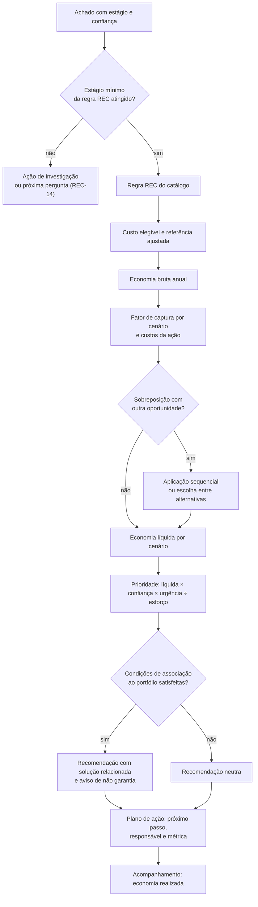
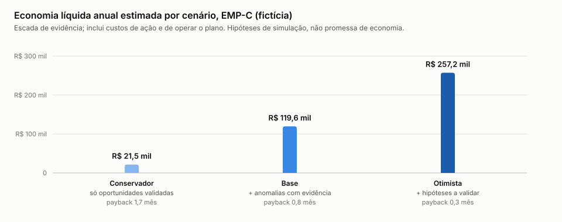

# Economia estimada e plano de ação

Especifica a capacidade C4 (Optimize) e atende a US-GF-05, US-GF-06, US-GF-07, US-CF-01, US-CF-02, US-CF-04 e US-SP-01. Toda premissa numérica não observada é **hipótese de simulação**, não promessa de redução de custos.

## 1. Conceitos

| Conceito | Definição |
|---|---|
| Custo elegível | Parte do custo que a alavanca consegue afetar. Exemplo: para preço de combustível, os litros comprados acima da referência; para NIC, o valor das multas NIC |
| Referência ajustada | Custo esperado nas mesmas condições (mesma atividade, mesmo período), vinda da hierarquia de [benchmarks](benchmarks.md) |
| Economia bruta potencial | Excesso do custo elegível sobre a referência ajustada, anualizado |
| Fator de captura | Fração da economia bruta que a ação consegue capturar, por cenário (hipótese) |
| Economia líquida | Economia capturada menos custos recorrentes da ação e do plano |
| Recuperação pontual | Valor já pago que pode ser contestado (cobrança duplicada, eixo suspenso). Fica fora da economia anual |
| Payback | Meses para a economia líquida pagar o custo de implantação |
| ROI em 12 meses | Ganho líquido sobre o custo total da iniciativa no horizonte |

## 2. Convenção de sinais e fórmulas

O briefing sugere "custo de referência ajustado − custo atual elegível". O projeto adota o **sinal invertido**, para que economia seja sempre um número positivo:

$$G_i = C^{\text{atual}}_{i,\text{elegível}} - C^{\text{ref}}_{i,\text{ajustado}} \qquad E^{\text{bruta}}_i = \max(0,\; G_i) \times f_{\text{anualização}}$$

$$E^{\text{líquida}}_k = \sum_{i \in S_k} \left( E^{\text{bruta}}_i \,\phi_{i,k} - R_i \right) - R_{\text{plano}} \qquad \text{Payback}_k = \frac{I_k}{E^{\text{líquida}}_k / 12} \qquad \text{ROI}_k = \frac{E^{\text{líquida}}_k - I_k}{I_k + R_k}$$

em que `i` é a oportunidade, `k` o cenário, `S_k` as oportunidades que entram no cenário, `φ` o fator de captura, `R` os custos recorrentes anuais (da ação e do plano), `I` o custo de implantação e `R_k` o total de custos recorrentes do cenário.

- **Gap negativo** (custo abaixo da referência) não gera economia e não compensa gaps positivos de outras oportunidades.
- **Anualização:** desvios medidos em 6 meses são multiplicados por 2 **somente** quando o desvio é persistente (exemplo: OP-C1); a premissa fica registrada.
- **Horizonte:** 12 meses, sem desconto financeiro. Para horizontes maiores (renovação de frota), a evolução prevista é o valor presente líquido com taxa informada pelo CFO.
- **ROI sobre o custo total.** Calcular o ROI só sobre a implantação produz percentuais enganosamente altos quando o investimento inicial é pequeno. Por isso o denominador inclui os custos recorrentes.

## 3. Cenários: escada de evidência

| Cenário | Entra | Fator de captura | Uso |
|---|---|---|---|
| **Conservador** | Só oportunidades validadas (regra determinística ou confirmação) | Conservador | Piso para decisão |
| **Base** | Validadas + anomalias com evidência estatística (confiança moderada ou maior) | Base | Planejamento |
| **Otimista** | Tudo, inclusive hipóteses que dependem de validação externa | Otimista | Teto, sempre rotulado |

Em cada cenário, entram apenas itens com economia líquida positiva. Os cenários diferem pelo **nível de evidência** e pela **captura**, não só por um multiplicador.

Fatores de captura adotados (hipóteses do grupo, a substituir por resultados medidos):

| Alavanca | Conservador | Base | Otimista | Justificativa da faixa |
|---|---|---|---|---|
| Multa NIC (REC-01) | 70% | 90% | 100% | Indicar o condutor no prazo elimina a NIC; resta o risco de condutor não identificável |
| Desconto perdido (REC-02) | 50% | 80% | 100% | Calendário de vencimentos resolve a maioria; notificações atrasadas limitam |
| Cobrança duplicada de pedágio (REC-07) | 50% | 80% | 100% | Conciliação automática detecta; a recuperação depende do emissor |
| Preço acima da referência (REC-04) | 30% | 50% | 70% | Depende de postos alternativos nas rotas |
| Queda de rendimento (REC-05) | 40% | 60% | 80% | Depende da causa: mecânica tende a ser recuperável, condução parcialmente |
| Eixo suspenso cobrado (REC-08) | 50% | 70% | 90% | Prevenção pela declaração de eixos; contestação com êxito incerto |
| Lotação sem Vale-Pedágio (REC-09) | 0% | 30% | 60% | Depende de contratos e de análise jurídica; por isso 0% no conservador |
| Subutilização (REC-11) | 0 de 3 veículos | 1 de 3 | 2 de 3 | Depende de validação operacional |
| Corretiva elevada (REC-10) | 20% | 35% | 50% | Plano preventivo reduz parte da corretiva, com custo recorrente maior |

O fator de captura e a escada de evidência atuam juntos. Uma hipótese, como a lotação sem Vale-Pedágio (OP-C4), tem fator "base" de 30% para exibir sua economia individual e calcular a prioridade, mas **só entra na soma do cenário otimista**, porque depende de validação contratual e jurídica. Por isso o cenário-base da EMP-C não inclui OP-C4.

Custos de ação usados no exemplo (hipóteses): diagnóstico mecânico R$ 1.500 por veículo; política de abastecimento R$ 2.000 de implantação e R$ 4.800/ano de monitoramento; rotina de conferência de eixos R$ 1.000; plano preventivo R$ 2.000 por veículo e R$ 300/mês de preventiva adicional por veículo; custo de operar o plano de R$ 12.000/ano (EMP-B) e R$ 30.000/ano (EMP-C), equivalente a dedicar parte do tempo de um analista.

## 4. Dupla contagem

1. **Separação por decomposição.** Preço e consumo são efeitos disjuntos da decomposição LMDI ([benchmarks](benchmarks.md#4-decomposição-atividade-intensidade-e-preço)); cada real de diferença pertence a um único efeito.
2. **Alavancas sobre o mesmo custo** se aplicam em sequência, não em soma:

$$E_{\text{conjunta}} = C\left[1 - \prod_j (1 - r_j)\right]$$

   Exemplo do anexo: sobre R$ 200.000, reduções de 6% e 4% somariam R$ 20.000, mas o efeito conjunto é R$ 19.520. A diferença de R$ 480 é a dupla contagem evitada.
3. **Alternativas excludentes** (plano preventivo × renovação do mesmo veículo) não entram juntas no mesmo cenário.
4. **Recuperação pontual** (cobranças passadas) não se soma à economia anual recorrente.
5. **Erro de dado não é economia.** Excluir duplicidades corrige o custo e não gera "economia" (na EMP-B, R$ 110.539,04 de combustível duplicado).

## 5. Priorização e próximo passo

$$\text{Prioridade}_i = \frac{E^{\text{líquida, base}}_i \times F_{\text{confiança}} \times F_{\text{urgência}}}{\text{esforço (pessoa-semana)}}$$

- **F confiança:** Alta = 1,0; Moderada = 0,75; Baixa = 0,5. É ordinal, não probabilidade.
- **F urgência:** 1,25 quando há prazo legal ou de contestação correndo (NIC, eixo suspenso, cobrança duplicada); 1,0 nos demais casos.
- **Esforço:** estimativa do grupo em pessoa-semana.
- **Portões:** ação inviável no horizonte não é priorizada; risco alto exige validação antes da execução.

A fórmula adapta a lógica do RICE (alcance × impacto × confiança ÷ esforço), que dá valor esperado por unidade de esforço. Aqui o "impacto" já vem em reais e o alcance está embutido na economia ([referências](referencias.md)).

**EMP-C** ([anexo, seção 8](anexos/exemplos-calculados.md#8-oportunidades-cenários-e-priorização)):

| Ordem | Oportunidade | Estágio | Bruta anual | Líquida (base) | Confiança | Prioridade |
|---|---|---|---|---|---|---|
| 1 | OP-C1 Queda de rendimento em 3 cavalos | anomalia | R$ 108.080 | R$ 64.848 | Moderada | 32.424 |
| 2 | OP-C2 Abastecimento acima da referência | validada | R$ 135.164 | R$ 62.782 | Alta | 31.391 |
| 3 | OP-C3 Eixo suspenso cobrado | validada | R$ 30.663 | R$ 21.464 | Moderada | 20.122 |
| 4 | OP-C4 Lotação sem Vale-Pedágio | hipótese | R$ 137.934 | só no otimista | Baixa | 10.345 |
| 5 | OP-C5 Multas NIC | validada | R$ 521 | R$ 469 | Alta | 1.171 |
| 6 | OP-C6 Multas sem desconto | validada | R$ 39 | R$ 31 | Alta | 125 |

**Próximo passo da EMP-C:** inspeção mecânica dirigida de C-V07, C-V15 e C-V22 e conversa com os condutores, com revalidação do rendimento em 30 dias.

**EMP-B:** o primeiro item é OP-B1 (multas NIC, R$ 2.033 por ano). É uma oportunidade pequena, mas validada, urgente e de esforço baixo.

## 6. Catálogo de recomendações

| Regra | Gatilho | Estágio mínimo | Ação sugerida | Responsável | Acompanhamento |
|---|---|---|---|---|---|
| REC-01 | Multa NIC no período | Validada | Rotina de indicação do condutor em até 30 dias da notificação (CTB, art. 257, § 7º) | Gestor de frota | Nº de NIC por trimestre (meta: zero) |
| REC-02 | Multa paga após o vencimento | Validada | Calendário de vencimentos; avaliar adesão ao sistema de notificação eletrônica (desconto de 40% sem defesa nem recurso, CTB, art. 284, § 1º) | Financeiro | % pagas com desconto |
| REC-03 | Infrações recorrentes por veículo ou condutor | Hipótese | Orientação de condução e revisão de rota | Gestor de frota | Multas por 10 mil km |
| REC-04 | Prêmio de preço acima da tolerância | Validada | Postos preferenciais por rota; alerta ou bloqueio acima da referência | Gestor de frota | Prêmio por litro (IND-08) |
| REC-05 | Queda persistente de rendimento (CUSUM) | Anomalia | Inspeção dirigida (injeção, filtros, pneus, calibragem) e conversa com o condutor | Manutenção | Razão km/L em relação aos pares, 30 e 90 dias |
| REC-06 | Volume acima do tanque ou combustível incompatível | Hipótese | Auditoria da transação e regras de abastecimento por veículo | Gestor de frota | Nº de transações bloqueadas ou auditadas |
| REC-07 | Passagem cobrada em duplicidade | Validada | Contestação junto ao emissor e conciliação automática mensal | Financeiro | Valor contestado e recuperado |
| REC-08 | Eixo suspenso cobrado em retorno vazio (Lei nº 13.103/2015, art. 17) | Validada | Contestação no prazo do emissor e conferência da declaração de eixos | Gestor de frota | Sobrecobrança por mês |
| REC-09 | Lotação sem registro de Vale-Pedágio, com pedágio pago pela transportadora | Hipótese | Verificar contratos, documento de transporte e Lei nº 10.209/2001 com o jurídico | Jurídico e comercial | Viagens regularizadas |
| REC-10 | Corretiva elevada em relação aos pares | Hipótese | Plano preventivo; avaliar renovação (análise separada, com custo de capital) | Manutenção | Corretiva por km, 6 meses |
| REC-11 | Utilização abaixo de 40% da mediana | Hipótese | Avaliar realocação ou desmobilização | Gestão | km/mês e custo fixo por veículo |
| REC-12 | Seguro por veículo acima dos pares | Hipótese | Cotação comparativa com o mesmo perfil de risco | Financeiro | Prêmio por veículo |
| REC-13 | Pedágio manual sem comprovante | Observação | Pagamento eletrônico para garantir comprovante e conciliação | Gestor de frota | % do pedágio com comprovante |
| REC-14 | Confiança insuficiente para concluir | Observação | Responder a próxima melhor pergunta | Gestor de frota | Largura da faixa e selo |

Para hipóteses, a ação recomendada é **investigar**, não executar. Achados que envolvem legislação apontam onde verificar, não constituem orientação jurídica.

## 7. Relação com o portfólio Sem Parar Empresas

A associação a uma solução só aparece quando **duas condições** são satisfeitas: (1) a causa do achado está no escopo funcional da solução; (2) o achado atingiu o estágio mínimo da regra. O texto sempre diz que a solução **pode ajudar** a executar a ação e nunca promete economia específica.

| Achado | Solução citada no briefing | Por que se relaciona | Condição de exibição |
|---|---|---|---|
| Preço acima da referência; transações incompatíveis | Multiabastece | Gestão de abastecimento; a página do aplicativo descreve regras de abastecimento por veículo e motorista e acompanhamento das transações | REC-04 validada ou REC-06 com 2 ou mais ocorrências |
| Cobrança duplicada; eixo suspenso; pedágio manual sem comprovante | Tag Sem Parar | Pagamento eletrônico com extrato conciliável | REC-07 ou REC-08 validada; REC-13 com 10% ou mais do pedágio sem comprovante |
| Lotação sem Vale-Pedágio | Vale-Pedágio | Antecipação do pedágio pelo contratante, conforme a Lei nº 10.209/2001 | REC-09 confirmada pelo cliente; mensagem voltada ao contratante do frete |
| NIC, desconto perdido, infrações recorrentes | Gestor de Multas | Controle de prazos e de indicação de condutor | REC-01 ou REC-02 validada |
| Corretiva elevada | Gestão de Manutenção | Planejamento preventivo | REC-10 confirmada pelo gestor |
| Seguro acima dos pares | Seguros | Cotação comparativa | REC-12 com grupo de comparação válido |

**Sem associação a redução de custo:** Antecipação de Recebíveis (produto financeiro, com custo próprio, que não reduz o custo da frota) e as soluções de Benefícios (fora do escopo de custo de frota). O escopo exato de Gestor de Multas, Gestão de Manutenção e Seguros não pôde ser confirmado em fonte pública e deve ser validado com a Sem Parar Empresas antes do piloto **[Pendência]**.

## 8. Fluxo de geração de recomendações

Este é o **diagrama do fluxo de geração de recomendações** da arquitetura.

## 9. Resultados no exemplo

| Empresa | Cenário | Itens | Economia líquida anual | Implantação | Payback | ROI 12 meses |
|---|---|---|---|---|---|---|
| EMP-C | Conservador | OP-C2, C3, C5, C6 | R$ 21.464 | R$ 3.000 | 1,7 mês | 49% |
| EMP-C | Base | + OP-C1 | R$ 119.594 | R$ 7.500 | 0,8 mês | 265% |
| EMP-C | Otimista | + OP-C4 | R$ 257.195 | R$ 7.500 | 0,3 mês | 590% |
| EMP-B | Conservador | OP-B1, B2, B3, B6 | -R$ 9.429 | R$ 2.000 | n/a | -82% |
| EMP-B | Base | OP-B1, B2, B3, B6 | -R$ 8.275 | R$ 2.000 | n/a | -73% |
| EMP-B | Otimista | + OP-B4, B5 | R$ 7.448 | R$ 10.000 | 16,1 meses | -7% |

Recuperação pontual, fora da economia anual: R$ 30.663 (EMP-C, eixo suspenso) e R$ 315 (EMP-B, cobrança duplicada).

**Sensibilidade (EMP-C, cenário-base).** Com captura 20% menor, a economia líquida cai para R$ 88.715; com custos de ação dobrados, para R$ 84.794; com as duas mudanças juntas, para R$ 53.915, e o ROI vai a 46%. O resultado continua positivo, mas o valor depende sobretudo da confirmação de OP-C1 e OP-C2.

**Leitura da EMP-B.** As oportunidades validadas são pequenas diante do custo de manter um plano dedicado, e o resultado líquido fica negativo nos cenários conservador e base. A recomendação honesta é executar as ações de processo (NIC, vencimentos) dentro da rotina atual, sem estrutura nova. Para essa frota, o maior valor do diagnóstico foi evitar uma conclusão errada: sem deduplicação, o combustível pareceria 8,2% maior. Uma calculadora que sempre encontra muita economia não é confiável.

## 10. Medição da economia realizada

Protocolo previsto para a capacidade C5, baseado na lógica de medição e verificação do IPMVP:

1. **Linha de base:** o indicador da alavanca nos 6 a 12 meses anteriores à ação (exemplo: litros por km de C-V07).
2. **Ajuste:** a linha de base é recalculada para as condições do período de relato: km rodados e preço do período (efeitos atividade e preço da decomposição).
3. **Economia realizada** = custo da linha de base ajustada − custo observado no período de relato.
4. **Período mínimo** de relato: 3 meses para combustível; 6 para manutenção.
5. **Atribuição:** se outras ações ocorreram no mesmo período e sobre o mesmo custo, a economia é reportada em conjunto, sem repartir de forma arbitrária.
6. **Registro:** cada medição gera uma linha em `economias_realizadas`, com método e versão.
