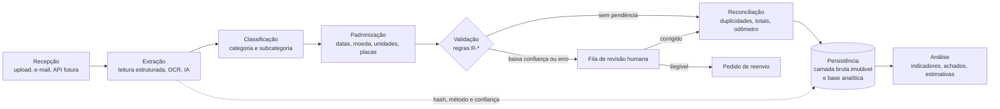

# Ingestão, padronização e qualidade dos dados

Este documento especifica a capacidade C1 (Understand) e atende diretamente a US-GF-01: o gestor envia os documentos como estão e o produto faz o trabalho de estruturar, sem esconder o que não conseguiu ler.

## 1. Fluxo de dados

Este é o **diagrama do fluxo de dados** da arquitetura.

| Etapa | Entrada | Saída | Quando falha |
|---|---|---|---|
| Recepção | Arquivo, texto colado ou chamada de API | Arquivo guardado na camada bruta, com hash SHA-256, tipo detectado e metadados | Arquivo maior que o limite, tipo não suportado ou suspeita de malware: rejeitado com mensagem |
| Extração | Arquivo bruto | Registros candidatos com campos, confiança por campo e localizador (linha, página, região) | Confiança abaixo do limite: fila de revisão. Ilegível: pedido de reenvio |
| Classificação | Registro candidato | Categoria e subcategoria de custo | Classe incerta: revisão humana |
| Padronização | Registro classificado | Formatos únicos (datas ISO 8601, decimal, unidades, placa normalizada e pseudonimizada) | Formato ambíguo: inferência por arquivo; se persistir, revisão |
| Validação | Registro padronizado | Registro com marcações das regras R-* | Severidade define o tratamento (seção 4) |
| Reconciliação | Registros válidos de várias fontes | Um registro canônico por fato, totais conciliados | Divergência acima da tolerância: pendência registrada |
| Persistência | Registros conciliados | Base analítica versionada, ligada à camada bruta | Falha transacional: nada é gravado pela metade |
| Análise | Base analítica | Indicadores, achados e estimativas ([diagnóstico](diagnostico.md)) | Dados insuficientes: estimativa com faixa e perguntas guiadas |

## 2. Processamento por formato

| Formato | Detecção | Extração prevista | Erros típicos | Revisão humana |
|---|---|---|---|---|
| **CSV** | Extensão, delimitador e codificação detectados por amostragem | Leitura estruturada, com mapeamento de colunas sugerido e confirmado pelo usuário na primeira vez | Separador `;` com decimal `,`; codificação Latin-1; cabeçalho em linha diferente da primeira | Só na confirmação do mapeamento |
| **XLSX** | Assinatura do arquivo | Leitura por planilha; detecção da linha de cabeçalho e de células mescladas | Totais e subtotais misturados às linhas; datas como número serial | Confirmação do mapeamento; linhas de total ignoradas |
| **Texto livre** (mensagem, e-mail, texto colado) | Ausência de estrutura tabular | Regras e expressões para valor, data, veículo e categoria; modelo de linguagem como alternativa futura, sempre com validação | Valores sem data; abreviações | Registros abaixo de 0,80 de confiança |
| **PDF com texto** (faturas, apólices, extratos, DANFE) | Camada de texto presente | Extração de texto e tabelas por posição | Tabelas quebradas entre páginas; colunas desalinhadas | Divergência entre soma dos itens e total do documento |
| **PDF escaneado** | Sem camada de texto | OCR com modelo de layout; extração orientada por esquema | Caracteres trocados (0/O, 1/l); vírgula decimal perdida | Campos monetários abaixo de 0,80 |
| **Imagem e print** (foto de nota, captura de tela) | Tipo de imagem | Correção de inclinação e contraste, OCR, extração por esquema; remoção de metadados EXIF, que podem conter localização | Reflexo, corte, baixa resolução | Abaixo de 0,80 ou soma inconsistente |
| **Extratos** (tag de pedágio, cartão de combustível) | Leiaute conhecido por emissor | Conectores de leiaute por emissor, versionados | Mudança de leiaute sem aviso | Quando o leiaute não é reconhecido |
| **NF-e (XML)** | Esquema da nota fiscal eletrônica | Leitura estruturada; para combustíveis, o grupo `comb` traz o código de produto da ANP (`cProdANP`), que classifica o combustível sem ambiguidade | XML sem o grupo de combustível | Raramente necessária |
| **API** (futuro) | Integração contratada | Coleta incremental autenticada | Indisponibilidade; mudança de contrato | Não se aplica |

O formato preferido para cada fato é o mais estruturado disponível: XML ou extrato antes de PDF, e PDF antes de foto. Essa ordem é a precedência usada na reconciliação (seção 5).

## 3. Padronização

| Item | Regra |
|---|---|
| Datas | ISO 8601; fuso America/Sao_Paulo. Ambiguidade DD/MM × MM/DD resolvida por arquivo: se algum valor tem dia acima de 12, o padrão do arquivo fica definido; se nenhum tiver, vale o padrão brasileiro, marcado para confirmação |
| Moeda | Decimal com precisão de centavo; detecção por arquivo de "1.234,56" × "1,234.56"; símbolo e espaços removidos; nunca usar ponto flutuante binário para valores monetários na aplicação |
| Unidades | Litros (L), quilômetros (km), reais (R$). Conversões explícitas e registradas, como m³ de GNV no futuro |
| Placas | Maiúsculas, sem hífen nem espaço; validadas no padrão antigo ou Mercosul (`^[A-Z]{3}[0-9][A-Z0-9][0-9]{2}$`); pseudonimizadas por HMAC para a base analítica |
| Fornecedores | CNPJ com 14 dígitos e dígitos verificadores; nome padronizado por catálogo |
| Categorias | Catálogo controlado de categoria e subcategoria; termo novo vira sugestão para curadoria, nunca categoria criada automaticamente |
| Competência | Mês do evento, ou intervalo de vigência para custos plurimensais ([modelagem](modelagem-dados.md#6-competência-e-rateio)) |

## 4. Regras de validação

Implementação de referência em [`src/calculos.py`](../src/calculos.py), função `validar`.

| Regra | O que verifica | Severidade | Tratamento | Cenário de teste |
|---|---|---|---|---|
| R-DUP-ARQ | Arquivo com hash já recebido | Bloqueante | Excluir os registros da segunda carga | G01 |
| R-DUP-REG | Mesma transação em duas fontes (mesmo veículo, litros e valor, até 15 min) | Bloqueante | Manter a fonte de maior precedência, excluir a outra | G11 |
| R-PED-DUP | Mesma praça, valor e veículo em até 5 min | Alta | Manter no custo (foi cobrado) e gerar achado de cobrança indevida | G02 |
| R-DATA-FUT | Data do evento posterior ao recebimento do documento | Alta | Quarentena | G16 |
| R-VALOR-NEG | Valor negativo sem identificação de estorno | Alta | Quarentena | G20 (e G33 como controle) |
| R-CONF-EXTRACAO | Confiança de extração abaixo de 0,80 | Média | Quarentena até revisão | G28, G32 (e G34 como controle) |
| R-VEIC-DESC | Veículo fora do cadastro | Alta | Manter no total da frota, fora dos indicadores por veículo | G18 |
| R-COMB-INCOMP | Combustível diferente do padrão da categoria | Alta | Manter o valor, fora do consumo; gerar achado para investigação | G19 |
| R-ABS-TANQUE | Litros acima de 105% do tanque | Alta | Manter o valor, fora do consumo | G14 |
| R-CONC-VALOR | Litros × preço diferente do valor (tolerância de R$ 0,05 ou 0,5%) | Média | Manter o valor, fora do consumo | G14, G17 |
| R-PRECO-FAIXA | Preço por litro fora da faixa plausível | Média | Manter o valor, fora das estatísticas de preço | G17 |
| R-ODO-REG | Odômetro menor que o maior já registrado | Média | Ignorar o odômetro do registro | G15 |
| R-CAMPO-AUSENTE | Litros ausentes com preço e valor presentes | Baixa | Imputar por IMP-01, com status IMPUTADO | G10 |

Os parâmetros (faixa de preço, tolerâncias, janelas de tempo) ficam em configuração versionada. A faixa de preço deve ser revista periodicamente com a série de preços da ANP.

## 5. Duplicidades e reconciliação

1. **Arquivo:** o hash SHA-256 identifica reenvio do mesmo arquivo, mesmo com outro nome.
2. **Transação entre fontes:** o mesmo abastecimento aparece no extrato do cartão e na nota fiscal. A chave é veículo, litros e valor arredondados, com janela de 15 minutos. Mantém-se a fonte de maior precedência: integração > extrato > CSV/XLSX > PDF com texto > OCR > texto livre > digitação. O registro descartado continua ligado ao canônico como evidência adicional.
3. **Passagem de pedágio:** a mesma praça cobrada duas vezes em até 5 minutos. Como o valor foi efetivamente cobrado, ele **permanece** no custo e vira achado de cobrança indevida, a ser contestada.
4. **Totais:** a soma dos itens extraídos deve bater com o total impresso no documento. Divergência acima de 0,5% gera pendência no documento inteiro.
5. **Coerência cruzada:** quilometragem do mês × litros × faixa de rendimento da categoria; viagens do sistema de transporte × pedágios registrados; vigência da apólice × parcelas pagas.

## 6. Documentos ilegíveis e erros de extração

| Confiança do campo | Tratamento |
|---|---|
| 0,95 ou mais | Aceito automaticamente; auditoria amostral periódica |
| 0,80 a 0,95 | Aceito, com marcação; entra na amostra de auditoria com prioridade |
| Abaixo de 0,80 | Fila de revisão humana; o valor fica em quarentena e fora dos totais |
| Ilegível ou sem campos obrigatórios | Pedido de reenvio, com orientação (foto mais nítida, PDF original) |

A extração por IA é sempre seguida de validação determinística: esquema dos campos, soma dos itens igual ao total, faixas plausíveis e coerência com o cadastro. Um valor que falha nessas verificações não é aceito, por maior que seja a confiança informada pelo modelo ([estratégia de IA](estrategia-ia.md)).

## 7. Correção humana e trilha

- A revisão mostra o recorte do documento ao lado do campo extraído.
- A correção grava o valor anterior (`valor_extraido_original`), quem corrigiu, quando e o motivo, e muda o status para CORRIGIDO. O cenário G34 testa essa trilha: registros corrigidos não são marcados novamente pelas regras.
- As correções formam um conjunto rotulado que melhora o classificador e a extração (Sprint 3 em diante), usado apenas para o próprio cliente ou de forma agregada, conforme a autorização registrada.

## 8. Lacunas: detectar e estimar sem esconder

Uma lacuna é diferente de zero. O produto detecta lacunas por três sinais:

1. Categoria esperada sem nenhum registro (EMP-A sem seguro nem IPVA).
2. Mês sem documento de uma fonte recorrente (EMP-C sem o extrato de pedágio de fevereiro de 2026).
3. Atividade sem custo correspondente (viagens do sistema de transporte sem pedágio registrado, nos veículos sem tag).

A lacuna recebe estimativa marcada como ESTIMADO, com método e faixa. Na massa sintética, a tarifa média por km das viagens com tag aplicada às viagens sem registro estimou o extrato ausente com erro de -3,3% e os pedágios manuais sem comprovante com erro de +5,6% ([anexo, seção 5](anexos/exemplos-calculados.md#5-multas-e-pedágio)).

## 9. Resultados na massa sintética

- As regras detectaram **todos** os registros injetados nos 13 cenários de problema de dado e **não marcaram** nenhum registro dos 2 controles negativos nem fora do gabarito. Como as regras foram escritas conhecendo os erros, isso prova a mecânica, não o desempenho em dados reais.
- A deduplicação removeu R$ 110.539,04 da EMP-B e R$ 82.171,57 da EMP-C. Sem ela, o combustível da EMP-B apareceria 8,2% maior, um "desvio" que não existe.
- Ficaram em quarentena R$ 3.313,84 na EMP-A (notas de oficina com OCR fraco) e R$ 25.156,49 na EMP-C (comprovantes manuais com OCR fraco, sinal invertido e data errada).
