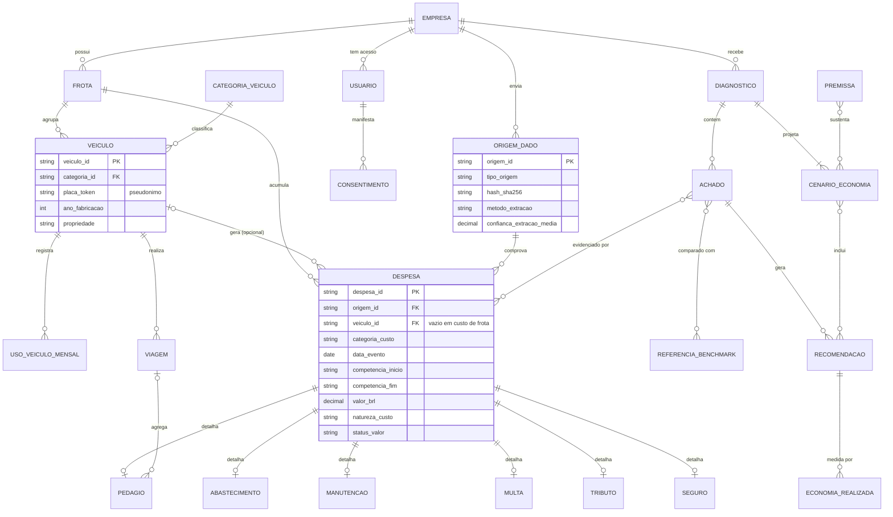
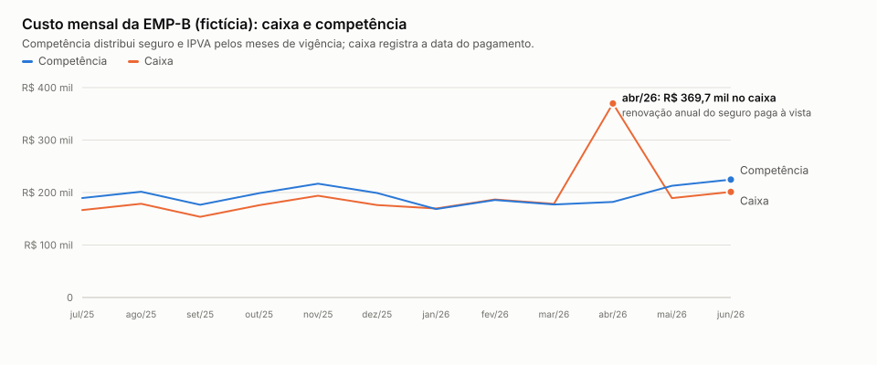

# Modelagem de dados

## 1. Princípios

1. **A despesa é o fato central.** Todo custo, de qualquer categoria, é uma linha em `despesas` com valor, data do evento, competência, categoria e origem. Os detalhes de cada categoria ficam em tabelas de especialização (abastecimento, manutenção, pedágio, multa, tributo, seguro).
2. **Nenhum valor sem origem.** Toda despesa aponta para um documento ou carga (`origens_dados`) e para o localizador dentro dele (linha, página, item). É isso que torna possível a trilha "dado → cálculo → recomendação".
3. **Status explícito.** Cada valor declara sua natureza: observado, corrigido, imputado, estimado ou não disponível. Nada é preenchido em silêncio.
4. **Evento × competência.** A data do evento registra quando o fato aconteceu; a competência registra a quais meses o custo pertence. Seguro anual e IPVA são rateados pelos meses de vigência, e isso separa pico de caixa de aumento de custo.
5. **Isolamento por cliente.** Toda tabela operacional carrega, direta ou indiretamente, o `empresa_id`, base para o isolamento entre clientes ([segurança](seguranca-lgpd.md)).
6. **Pseudonimização na análise.** Placas, números de auto de infração, apólices e condutores aparecem nas análises como pseudônimos. Os valores originais ficam apenas na camada bruta, cifrados.

## 2. Modelo conceitual

O diagrama abaixo é o **diagrama conceitual de entidades** da arquitetura. "Período de apuração" e "categoria de custo" não viraram tabelas próprias: o período é o atributo de competência (mês) e a janela do diagnóstico, e a categoria é um catálogo controlado. Assim se evitam junções sem ganho de informação.

| Relação | Cardinalidade | Regra |
|---|---|---|
| Empresa → Frota | 1 para 1..N | Uma empresa pode ter várias operações (filiais, contratos) |
| Frota → Veículo | 1 para 0..N | Veículo pertence a uma frota por vez |
| Categoria de veículo → Veículo | 1 para 0..N | Categoria define combustível padrão, eixos e tanque |
| Veículo → Uso mensal | 1 para 0..N | Uma linha por veículo e competência; km pode ser não disponível |
| Origem → Despesa | 1 para 0..N | Despesa sem origem é rejeitada |
| Veículo → Despesa | 0..1 para 0..N | Custos de frota (apólice coletiva, telemetria) não têm veículo e são rateados por veículo·mês |
| Despesa → Especialização | 1 para 0..1 | Uma tabela de detalhe por categoria; estornos não têm detalhe |
| Viagem → Pedágio | 0..1 para 0..N | Pedágio consolidado por viagem quando há dados de viagem (TMS) |
| Multa NIC → Multa original | 0..1 para 1 | A NIC referencia a multa que a originou |
| Diagnóstico → Achado → Recomendação | 1 para 0..N em cada nível | Achado registra evidências e registros de origem |
| Cenário ↔ Recomendação | N para N | Cenário inclui recomendações não sobrepostas |
| Recomendação → Economia realizada | 1 para 0..N | Medições periódicas após a execução |

## 3. Dicionário de dados

O dicionário completo está em [`data/dicionario-dados.csv`](../data/dicionario-dados.csv): **181 campos em 23 tabelas**. Para cada campo há nome, descrição, tipo, unidade, obrigatoriedade, regra de validação (em texto e em forma verificável por script), origem, sensibilidade, exemplo e política para dado ausente. A coluna `presente_na_massa_sintetica` indica quais campos aparecem nos CSVs; o validador confere que as colunas dos 14 arquivos sintéticos e o dicionário coincidem nos dois sentidos ([validação](validacao.md)).

| Grupo | Tabelas | Campos |
|---|---|---|
| Cadastro | `empresas`, `frotas`, `categorias_veiculo`, `veiculos` | 31 |
| Uso e origem | `uso_veiculo_mensal`, `origens_dados` | 16 |
| Despesas e especializações | `despesas`, `abastecimentos`, `manutencoes`, `pedagios`, `multas`, `tributos`, `seguros` | 74 |
| Contexto operacional | `viagens` | 10 |
| Especificadas, sem massa sintética | `usuarios`, `consentimentos`, `referencias_benchmark`, `diagnosticos`, `achados`, `recomendacoes`, `cenarios_economia`, `premissas`, `economias_realizadas` | 50 |

**Classes de sensibilidade** usadas no dicionário:

| Classe | Significado | Exemplos |
|---|---|---|
| Público | Dado de referência público | valores de multa do CTB, catálogo de categorias |
| Interno | Identificadores e metadados técnicos | `despesa_id`, `hash_sha256` |
| Confidencial-cliente | Dado empresarial do cliente, protegido por sigilo comercial (não é dado pessoal) | valores, fornecedores, rotas, CNPJ |
| Pessoal-pseudonimizado | Dado que identifica pessoa indiretamente, substituído por pseudônimo | `condutor_token`, `placa_token` |
| Pessoal | Dado pessoal identificável, mínimo necessário | nome e e-mail do usuário |

Recorte do dicionário para a tabela central:

| Campo | Descrição | Tipo | Unidade | Obrig. | Validação | Origem | Sensibilidade | Exemplo | Se ausente |
|---|---|---|---|---|---|---|---|---|---|
| `despesa_id` | Identificador da despesa | texto | - | Sim | Único | Sistema | Interno | DSP-B-000123 | Não se aplica |
| `origem_id` | Documento de origem | texto | - | Sim | Existe em `origens_dados` | Sistema | Interno | ORG-B-0003 | Registro rejeitado |
| `veiculo_id` | Veículo; vazio em custo de frota | texto | - | Não | Existe em `veiculos` (R-VEIC-DESC) | Documento | Interno | B-V05 | Rateado por veículo·mês |
| `categoria_custo` | Categoria | categoria | - | Sim | COMBUSTIVEL, MANUTENCAO, PEDAGIO, MULTA, TRIBUTO, SEGURO, OUTROS | Classificador | Interno | PEDAGIO | Revisão humana |
| `data_evento` | Data do fato gerador | data | AAAA-MM-DD | Sim | Não posterior ao recebimento (R-DATA-FUT) | Documento | Confidencial-cliente | 2025-11-14 | Registro rejeitado |
| `competencia_inicio`, `competencia_fim` | Meses a que o custo pertence | mês | AAAA-MM | Sim | fim ≥ início | Regra de competência | Interno | 2025-04 a 2026-03 | Mês do evento |
| `valor_brl` | Valor | decimal | R$ | Sim | Negativo só em estorno (R-VALOR-NEG) | Documento | Confidencial-cliente | 156,18 | Registro rejeitado |
| `natureza_custo` | Quem suporta o custo | categoria | - | Sim | proprio, custeado_terceiro, reembolsavel | Regra de negócio | Confidencial-cliente | custeado_terceiro | Assume proprio |
| `status_valor` | Natureza do valor | categoria | - | Sim | Ver seção 4 | Sistema | Interno | OBSERVADO | - |
| `confianca_extracao` | Confiança da extração | decimal | 0 a 1 | Cond. | Abaixo de 0,80 vai para revisão | Extração | Interno | 0,71 | Vazio em leitura estruturada |

## 4. Status do valor e imputações

| Status | Definição | Exemplo | Como aparece para o usuário |
|---|---|---|---|
| **OBSERVADO** | Valor lido de documento ou integração, sem alteração | Litros do extrato do cartão | Valor normal |
| **CORRIGIDO** | Valor alterado por uma pessoa na revisão; o valor extraído fica em `valor_extraido_original` | Nota de oficina com vírgula lida como milhar (cenário G34) | Ícone de edição e histórico |
| **IMPUTADO** | Campo de **um registro** preenchido por regra determinística documentada | Litros = valor ÷ preço (IMP-01) | Marcação "calculado" e regra aplicada |
| **ESTIMADO** | Valor **agregado** não observado, inferido por premissas | Seguro da EMP-A, sem apólice enviada | Faixa, nunca valor único, e parcela estimada no total |
| **NAO_DISPONIVEL** | Não há dado e não é possível derivar com segurança | km de veículo sem odômetro | Indicador não calculado e pergunta guiada |

Imputações permitidas (todas registradas no campo e no log):

| Regra | Quando | Fórmula | Limite |
|---|---|---|---|
| IMP-01 | Litros ausentes; preço e valor presentes | litros = valor ÷ preço | Só se o preço estiver na faixa plausível |
| IMP-02 | Preço ausente; litros e valor presentes | preço = valor ÷ litros | Só se litros ≤ 105% do tanque |
| IMP-03 | Hora ausente | data às 12:00 | Não usar o registro em regras de duplicidade por horário |

Quilometragem nunca é imputada por regra. Quando falta, o veículo fica sem custo por km e o produto pergunta pelo odômetro.

## 5. Massa de dados sintéticos

**Finalidade.** Testar a coerência do modelo, das regras de qualidade e dos métodos de diagnóstico, e reproduzir os exemplos numéricos da documentação. **Não é dado real e não representa o mercado.**

**Geração.** [`src/gerar_dados_sinteticos.py`](../src/gerar_dados_sinteticos.py), com semente fixa 20260710 e saída determinística: duas execuções geram arquivos idênticos. Os parâmetros estão em [`data/parametros-simulacao.csv`](../data/parametros-simulacao.csv), cada um classificado como hipótese de simulação, valor legal (com o dispositivo citado) ou convenção. Data de referência da análise: 10/07/2026.

| Empresa fictícia | Perfil | Veículos | Período | Situação dos dados |
|---|---|---|---|---|
| EMP-A | Serviços técnicos urbanos, frota pequena | 8 (4 utilitários e 2 automóveis próprios, 2 automóveis locados) | out/2025 a mar/2026 | Incompleta: sem seguro, IPVA e multas; manutenção só de 3 meses; 3 veículos sem odômetro; dados desatualizados |
| EMP-B | Distribuição regional, frota média | 30 (10 VUC, 12 caminhões toco, 8 utilitários) | jul/2025 a jun/2026 | Completa, com duplicidades, multas NIC e custos justificáveis |
| EMP-C | Transporte rodoviário de longa distância, frota maior | 40 (28 cavalos mecânicos com semirreboque, 12 caminhões truck) | jul/2025 a jun/2026 | Completa, com viagens (TMS), lacunas de pedágio e problemas de extração |

| Tabela | Linhas | Tabela | Linhas |
|---|---|---|---|
| `despesas` | 21.656 | `uso_veiculo_mensal` | 888 |
| `pedagios` | 12.031 | `tributos` | 560 |
| `abastecimentos` | 7.936 | `origens_dados` | 463 |
| `viagens` | 3.668 | `veiculos` | 78 |
| `manutencoes` | 770 | `multas` | 72 |
| `seguros` | 14 | cadastros (`empresas`, `frotas`, `categorias_veiculo`) | 12 |

**Coerência matemática preservada pelo gerador:** litros × preço = valor (até o centavo); odômetro crescente na ordem dos abastecimentos; quilometragem mensal igual à soma dos trechos entre abastecimentos; tarifa de pedágio proporcional aos eixos cobrados; multa NIC igual a 2 vezes a original (CTB, art. 257, § 8º); descontos de 20% e 40% conforme o art. 284; prazo de indicação de 30 dias (art. 257, § 7º).

**Cenários injetados.** São 34, com gabarito em [`gabarito_cenarios.csv`](../data/sintetico/gabarito_cenarios.csv) e os registros afetados em [`gabarito_registros.csv`](../data/sintetico/gabarito_registros.csv):

| Tipo | Qtd. | Exemplos |
|---|---|---|
| Problema de dado | 13 | arquivo reenviado (G01), mesma transação em duas fontes (G11), litros × 10 (G14), odômetro regressivo (G15), data no futuro (G16), preço com vírgula deslocada (G17), veículo fora do cadastro (G18), sinal invertido (G20), OCR com baixa confiança (G28, G32) |
| Lacuna | 6 | extrato de pedágio ausente (G21), pedágio manual sem comprovante (G22), categorias não enviadas (G29), km ausente (G09, G27), dado desatualizado (G31) |
| Achado de negócio | 8 | multas NIC (G03), queda de rendimento (G12), preço acima da referência (G13), lotação sem Vale-Pedágio (G23), eixo suspenso cobrado (G24) |
| Custo alto, mas justificável | 5 | seguro pago à vista (G07), revisão completa programada (G08), sinistro (G25), volume alto (G26), veículos locados (G30) |
| Controle negativo | 2 | estornos legítimos (G33) e correções humanas (G34), que as regras **não** devem marcar |

**Limitações da massa sintética.**

- Os parâmetros são hipóteses do grupo. As distribuições reais de preço, consumo e manutenção devem ser obtidas de dados reais e fontes públicas, como a ANP para preços.
- As regras de detecção foram escritas conhecendo os erros injetados. A detecção de 100% comprova a mecânica, não o desempenho em dados reais.
- O gerador e os métodos de estimativa compartilham a mesma família de hipóteses. Testes de calibração com estes dados são demonstrações do procedimento.
- Veículos flex foram simulados só com gasolina, e o conjunto cavalo mais semirreboque é tratado como uma unidade de custo.

## 6. Competência e rateio

- **Custo de evento** (abastecimento, passagem, multa, manutenção): competência igual ao mês do evento.
- **Custo de vigência** (seguro, IPVA, licenciamento, locação): rateio linear entre `competencia_inicio` e `competencia_fim`.
- **Custo de frota sem veículo** (apólice coletiva, telemetria): rateado igualmente entre os veículos ativos de cada mês. Para análises de custo fixo por veículo, a apólice é rateada pelo valor de referência de cada um ([anexo](anexos/exemplos-calculados.md#4-manutenção-e-utilização-emp-b)).
- **Custo de terceiros** (pedágio custeado por Vale-Pedágio recebido): fica fora do custo próprio e aparece em separado.

O efeito aparece no anexo: na EMP-B, abril de 2026 tem R$ 369.725,51 de caixa e R$ 182.167,09 de competência, porque a renovação anual do seguro foi paga à vista.

