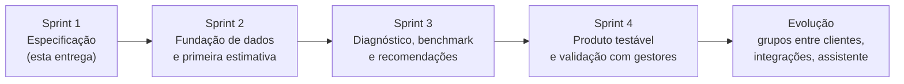

# Roadmap, responsabilidades e Kanban

## 1. Premissa de calendário

O briefing prevê "aplicação funcional testada com gestores reais [...] entregue ao final de 8 meses". O calendário oficial das Sprints não estava disponível neste ambiente **[Pendência]**. **Hipótese de planejamento:** quatro Sprints de cerca de dois meses, sendo esta (Sprint 1) a de especificação. Se o calendário tiver outra quantidade de Sprints, os incrementos abaixo são reagrupados mantendo a ordem de dependência.

## 2. Sprints

### Sprint 1: especificação (esta entrega)

| Item | Conteúdo |
|---|---|
| Objetivo | Especificar produto, dados, métodos, arquitetura e plano, com rastreabilidade às 20 User Stories |
| Entregáveis | Documentação em `docs/`, dicionário e massa sintética em `data/`, scripts de verificação em `src/`, diagramas, wireframes, roteiro do vídeo |
| Dependências | Briefing e template FIAP |
| Critérios de aceite | Matriz de conclusão em [validação](validacao.md#5-matriz-de-critérios-de-conclusão) sem item obrigatório pendente por falha do grupo; validador sem falhas |
| Riscos | Enunciado oficial não conferido; revisão do grupo insuficiente |
| Evidências | Este repositório e o vídeo publicado |

### Sprint 2: fundação de dados e primeira estimativa

| Item | Conteúdo |
|---|---|
| Objetivo | Receber dados estruturados, consolidar custos e entregar a estimativa progressiva |
| Entregáveis | Banco PostgreSQL com isolamento por cliente; ingestão de CSV, XLSX e extratos; regras R-*; indicadores IND-01 a IND-05; estimativa N0 a N2 com perguntas guiadas; autenticação, perfis e consentimento; interface de envio, revisão e painel consolidado |
| Dependências | Modelo e dicionário de dados (Sprint 1) |
| Critérios de aceite | Regras detectam todos os cenários de erro do gabarito e não marcam os controles; totais iguais à soma dos registros válidos; teste de vazamento entre clientes aprovado; primeira estimativa em até 5 minutos em teste interno |
| Riscos | Subestimar autenticação e isolamento; mudança de leiaute de extratos |
| Evidências | Pipeline verde; relatório dos testes sobre a massa sintética; demonstração gravada |

### Sprint 3: diagnóstico, benchmark e recomendações

| Item | Conteúdo |
|---|---|
| Objetivo | Transformar dados em achados com evidência e em plano de ação com economia por cenário |
| Entregáveis | Extração de PDF e imagem (comparação de três alternativas); IND-06 a IND-12; z modificado, CUSUM e decomposição LMDI; benchmarks com regras BEN; catálogo REC revisado com a Sem Parar Empresas; cenários e priorização; calibração das premissas por backtest; painel de diagnóstico |
| Dependências | Sprint 2; amostra rotulada de documentos; revisão do catálogo pela Sem Parar Empresas |
| Critérios de aceite | Precisão de 98% nos campos monetários aceitos sem revisão; cobertura P10-P90 entre 70% e 90% no backtest, com erros nas duas caudas; achados esperados do gabarito detectados e casos justificáveis não marcados; teste de dupla contagem aprovado |
| Riscos | Qualidade de fotos reais; viés das premissas; catálogo sem validação externa |
| Evidências | Relatório de avaliação da extração; relatório do backtest; diagnóstico de exemplo reproduzível |

### Sprint 4: produto testável e validação

| Item | Conteúdo |
|---|---|
| Objetivo | Entregar a aplicação funcional, com relatório exportável, e testá-la com gestores reais |
| Entregáveis | Relatório executivo em PDF; atualização mensal, lembretes e economia realizada; painel interno com autorização e auditoria; checklist OWASP ASVS nível 2 e teste de intrusão; testes de usabilidade; vídeo final |
| Dependências | Sprints 2 e 3; acesso a gestores (via Sem Parar Empresas ou rede do grupo) com consentimento |
| Critérios de aceite | Relatório em até 10 s para 100 veículos e 12 meses; SUS igual ou maior que 70 com 5 a 8 gestores (meta do grupo; a média de referência citada na literatura é 68); nenhuma vulnerabilidade alta aberta |
| Riscos | Falta de acesso a gestores reais; dados reais com qualidade abaixo da simulada |
| Evidências | Relatório de testes com usuários; métricas de uso; vídeo |

### Evolução (após o MVP)

Grupos de referência entre clientes (US-SP-03), integrações por API, referência de preços com dados abertos da ANP, assistente explicativo com verificação numérica (IA-06) e modelos estatísticos hierárquicos para as estimativas.

## 3. Equipe e responsabilidades

Papéis propostos para os 5 integrantes (Bruna Collavite, Fabio Guntovitch, Fabrizzio Riccelli, Gabriel Tamais e Natasha Zonta). A distribuição de cada pessoa por papel é decisão do grupo **[Pendência]**.

| Papel | Responsabilidades principais |
|---|---|
| **R1 Produto e documentação** | User Stories, priorização, catálogo de recomendações com a Sem Parar Empresas, critérios de aceite, entregas no portal |
| **R2 Engenharia de dados** | Ingestão, regras de qualidade, modelo de dados, massa sintética, atualização mensal |
| **R3 Ciência de dados** | Indicadores, estimativa e calibração, desvios, benchmarks, economia e cenários |
| **R4 Arquitetura e segurança** | Backend, banco, isolamento, autenticação, LGPD, infraestrutura e integração contínua |
| **R5 UX, interface e comunicação** | Jornadas, wireframes, interface, relatório executivo, testes de usabilidade, vídeo |

Matriz RACI (R = executa, A = aprova, C = consultado, I = informado):

| Entrega | R1 | R2 | R3 | R4 | R5 |
|---|---|---|---|---|---|
| Matriz de User Stories e priorização | R/A | C | C | C | C |
| Ingestão e qualidade | C | R/A | C | C | I |
| Indicadores, estimativa e diagnóstico | C | C | R/A | I | C |
| Economia e recomendações | A | I | R | I | C |
| Arquitetura, segurança e LGPD | C | C | I | R/A | I |
| Interface e relatório | C | I | C | C | R/A |
| Vídeo e entrega no portal | R/A | C | C | C | R |

## 4. Kanban

Colunas: **Backlog → A fazer → Em andamento → Em revisão → Concluído**. A lista completa, com critério de aceite e evidência de cada cartão, está em [`docs/anexos/kanban.csv`](anexos/kanban.csv), pronta para copiar para o Trello ou ferramenta equivalente.

| Coluna | Cartões | Conteúdo |
|---|---|---|
| Backlog | 22 | Sprints 2 a 4 (K-101 a K-306) |
| A fazer | 7 | Ações externas da Sprint 1: decidir FIAP NEXT, dar acesso a `fiap-tutoria`, revisão do grupo, gravar e publicar o vídeo, conferir o enunciado, entregar o .txt |
| Em andamento | 0 | - |
| Em revisão | 18 | Documentos e artefatos da Sprint 1 e identificação dos integrantes no README, aguardando a revisão do grupo |
| Concluído | 0 | Nenhum cartão sem revisão do grupo |

**Definição de concluído.** Um cartão só vai para "Concluído" com: (1) evidência verificável (arquivo, commit ou link); (2) critério de aceite atendido; (3) revisão de pelo menos um integrante que não o produziu. Por isso nenhum artefato desta Sprint está marcado como concluído antes da revisão do grupo.

## 5. Riscos do projeto

| Código | Risco | Prob. | Impacto | Mitigação | Dono |
|---|---|---|---|---|---|
| RSK-01 | Enunciado oficial com exigência não coberta | Média | Alto | Conferir o portal com a matriz de conclusão (K-024) | R1 |
| RSK-02 | Grupo não domina o conteúdo produzido | Média | Alto | Revisão distribuída (K-021) e perguntas da banca em [teste adversarial](teste-adversarial.md) | Todos |
| RSK-03 | Sem acesso a dados ou gestores reais | Alta | Alto | Massa sintética, roteiro de entrevista e pedido formal à Sem Parar Empresas | R1 |
| RSK-04 | Extração de fotos abaixo da meta | Média | Médio | Comparar alternativas; priorizar extratos estruturados; revisão em lote | R3 |
| RSK-05 | Premissas enviesadas na estimativa | Alta | Médio | Backtest e calibração como critério de aceite | R3 |
| RSK-06 | Associação comercial percebida como empurrada | Média | Alto | Regras de associação, linguagem sem promessa e revisão do catálogo | R1 |
| RSK-07 | Tratamento de dados sem base legal | Baixa | Alto | Validação jurídica antes do piloto; consentimento por finalidade | R4 |
| RSK-08 | Escopo maior que o tempo | Média | Alto | MoSCoW; *Could* só após os *Must* | R1 |
| RSK-09 | Vazamento entre clientes | Baixa | Alto | Isolamento no banco e testes automatizados | R4 |
| RSK-10 | Vídeo acima de 5 minutos | Média | Médio | Roteiro com contagem de palavras e ensaio cronometrado | R5 |
