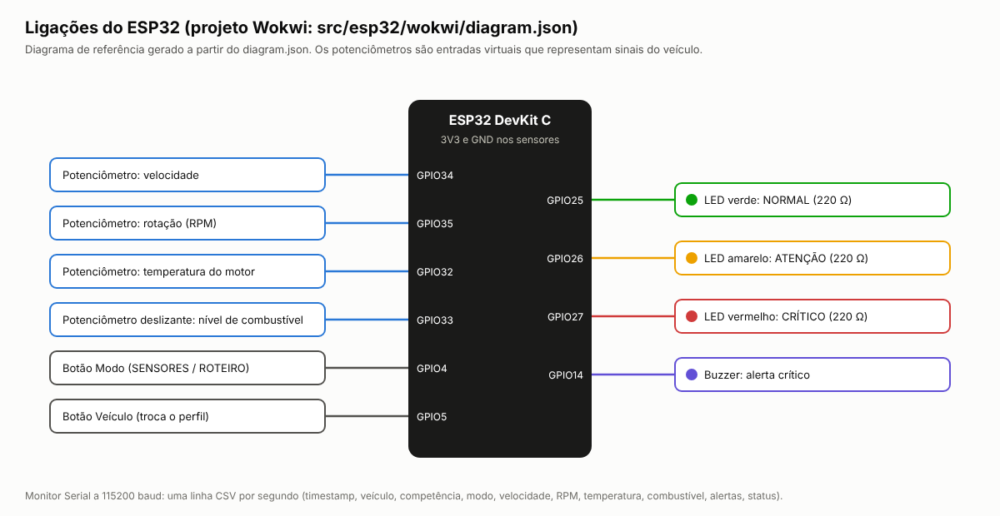
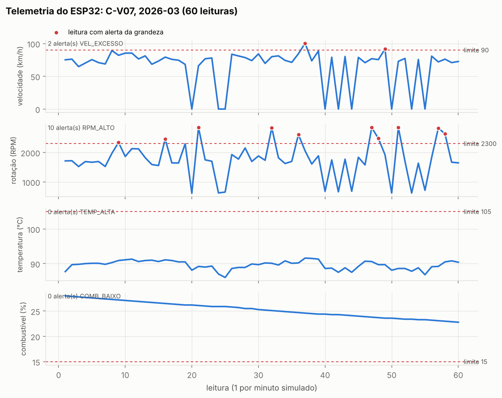

# Telemetria simulada com ESP32 e Wokwi

Código: `src/esp32/`. Leituras: `data/telemetria/telemetria_esp32.csv`. Evidências: `docs/sprint2/evidencias/`.

## 1. O que o circuito representa

O ESP32 faz o papel de um módulo de telemetria instalado no veículo. As quatro grandezas são **entradas virtuais**: no Wokwi, três potenciômetros e um potenciômetro deslizante representam os sinais que, num veículo real, viriam do barramento do motor (OBD-II ou CAN) e do sensor de nível do tanque. Não há sensor físico de velocidade, rotação ou temperatura no circuito.



*Diagrama de referência gerado a partir de `src/esp32/wokwi/diagram.json`; não é captura de tela do Wokwi.*

| Componente | Pino | Função |
|---|---|---|
| Potenciômetro | GPIO34 | Velocidade (0 até o limite de rodovia + 40 km/h) |
| Potenciômetro | GPIO35 | Rotação do motor (0 até 130% do limite de RPM) |
| Potenciômetro | GPIO32 | Temperatura do líquido de arrefecimento (40 a 120 °C) |
| Potenciômetro deslizante | GPIO33 | Nível de combustível (0 a 100%) |
| Botão "Modo" | GPIO4 | Alterna entre SENSORES (potenciômetros) e ROTEIRO (leituras geradas pelo perfil) |
| Botão "Veículo" | GPIO5 | Troca o veículo monitorado (B-V23, B-V12, C-V07) |
| LED verde, amarelo, vermelho (220 Ω) | GPIO25, 26, 27 | Estado NORMAL, ATENÇÃO e CRÍTICO |
| Buzzer | GPIO14 | Bipe em leitura crítica |

## 2. Funcionamento

1. A cada segundo (`INTERVALO_MS = 1000`), o firmware obtém uma leitura: dos potenciômetros, no modo SENSORES, ou gerada a partir do perfil do veículo, no modo ROTEIRO.
2. A leitura é arredondada para a resolução impressa e comparada com os limites da categoria do veículo.
3. O estado é sinalizado nos LEDs e no buzzer.
4. Uma linha CSV é escrita no Monitor Serial: `timestamp_s, veiculo_id, competencia, modo, leitura, velocidade_kmh, rpm, temperatura_c, nivel_combustivel_pct, alertas, status`.

O veículo monitorado é identificado pelo mesmo código do cadastro da frota, e cada linha traz a competência, o que permite integrar a telemetria com os custos no Python.

**Modo lote.** O mesmo arquivo `.ino` é compilado no computador com g++ e uma camada mínima da API Arduino (`src/esp32/nativo/`). Nesse modo, gera 60 leituras (1 por minuto simulado) para cada um dos 867 veículo-mês da frota e produz o CSV usado pelo pipeline: `python src/simulacao/gerar_telemetria.py`. O gerador pseudoaleatório é próprio do firmware, então a sequência é a mesma no ESP32 e no computador. O teste `test_firmware_compila_e_gera_a_mesma_telemetria` recompila o firmware e confere que a saída é idêntica ao CSV versionado.

## 3. Limites e justificativas

| Anomalia | Código | Leve | Médio | Pesado | Justificativa |
|---|---|---|---|---|---|
| Temperatura alta | TEMP_ALTA | 105 °C | 105 °C | 105 °C | Motores operam normalmente entre 85 e 95 °C. Acima de 105 °C indica falha de arrefecimento, e manter o veículo rodando pode danificar o motor |
| Rotação alta | RPM_ALTO | 4.500 | 2.600 | 2.300 | Motor a gasolina leve: faixa econômica até cerca de 3.000 RPM. Diesel de caminhão: torque máximo entre 1.100 e 1.800 RPM. Acima do limite, o consumo e o desgaste sobem sem ganho de tração |
| Faixa verde (não gera alerta) | - | 3.000 | 2.000 | 1.800 | Usada como atributo do modelo (% de leituras acima da faixa econômica) |
| Excesso de velocidade | VEL_EXCESSO | 60 km/h urbano; 110 km/h rodovia | 60; 90 | 60; 90 | Política operacional do grupo: 60 km/h em vias urbanas arteriais e 90 km/h para veículos de carga em rodovia, alinhados aos limites usuais do Código de Trânsito Brasileiro para essas vias e veículos. Velocidade acima disso também é incompatível com o cenário simulado |
| Combustível baixo | COMB_BAIXO | 15% | 15% | 15% | Reserva operacional: abaixo dela o veículo pode parar fora da rota de postos credenciados |
| Sinal incoerente | SENSOR_INCOERENTE | velocidade > 20 km/h com rotação < 300 | | | Um motor não move o veículo a 20 km/h com rotação quase zero: é falha do sinal, não do veículo |

**Estados:** NORMAL sem alerta; ATENÇÃO com um alerta de rotação, velocidade ou combustível; CRÍTICO com temperatura alta, sinal incoerente ou dois alertas ao mesmo tempo. Os mesmos limites estão em `src/esp32/firmware/telemetria_frota/limites.h` e em `src/frota_pulse/config.py`; o teste `test_alertas_do_firmware_batem_com_os_limites_do_python` confere, leitura por leitura, que os dois concordam.

## 4. Resultados

| Status | Leituras |
|---|---|
| NORMAL | 45.692 |
| ATENÇÃO | 5.259 |
| CRÍTICO | 1.069 |
| **Total** | **52.020** |

Alertas: RPM_ALTO 3.519, VEL_EXCESSO 2.147, COMB_BAIXO 606, TEMP_ALTA 450 e SENSOR_INCOERENTE 151. As leituras com sinal incoerente são tratadas pela regra de qualidade Q16: a rotação dessa leitura não entra nas médias.



*C-V07 em março de 2026, um dos caminhões com queda de rendimento desde janeiro: rotação acima do limite em 10 das 60 leituras e 2 excessos de velocidade; temperatura (máxima de 91,6 °C) e combustível (mínimo de 22,8%) dentro dos limites.*

Exemplo do Monitor Serial nos perfis de demonstração ([evidencias/monitor_serial_demo.txt](evidencias/monitor_serial_demo.txt)):

```
timestamp_s,veiculo_id,competencia,modo,leitura,velocidade_kmh,rpm,temperatura_c,nivel_combustivel_pct,alertas,status
2580,B-V12,2026-06,lote,44,71.7,1824,105.2,57.0,TEMP_ALTA,CRITICO
2640,B-V12,2026-06,lote,45,69.2,1878,107.4,56.9,TEMP_ALTA,CRITICO
2700,B-V12,2026-06,lote,46,64.9,1754,109.6,56.8,TEMP_ALTA,CRITICO
```

## 5. Como simular no Wokwi

1. Em [wokwi.com](https://wokwi.com), crie um projeto **ESP32** (Arduino).
2. Substitua o `diagram.json` pelo conteúdo de [src/esp32/wokwi/diagram.json](../../src/esp32/wokwi/diagram.json).
3. Substitua o `sketch.ino` pelo conteúdo de [src/esp32/firmware/telemetria_frota/telemetria_frota.ino](../../src/esp32/firmware/telemetria_frota/telemetria_frota.ino).
4. Adicione os arquivos `limites.h`, `perfil.h` e `perfis_demo.h` da mesma pasta (botão "+" ao lado das abas). O `perfis_lote.h` não é necessário no Wokwi.
5. Inicie a simulação. Gire os potenciômetros para provocar cada alerta; aperte "Modo" para ver o roteiro do veículo e "Veículo" para trocar de perfil.
6. Copie o conteúdo do Monitor Serial para um arquivo `.csv`: ele tem o mesmo formato lido pelo pipeline.
7. Salve o projeto, copie o link e registre-o no README.

**Pendente (ação do grupo):** o link público do projeto no Wokwi e as capturas de tela da simulação. A criação do projeto exige login no wokwi.com, e a compilação para o ESP32 de verdade não pôde ser feita neste ambiente (o download das ferramentas do ESP32 foi bloqueado pela rede). O firmware foi validado com compilação nativa sem avisos (`-Wall -Wextra`) e pelos testes automatizados.
