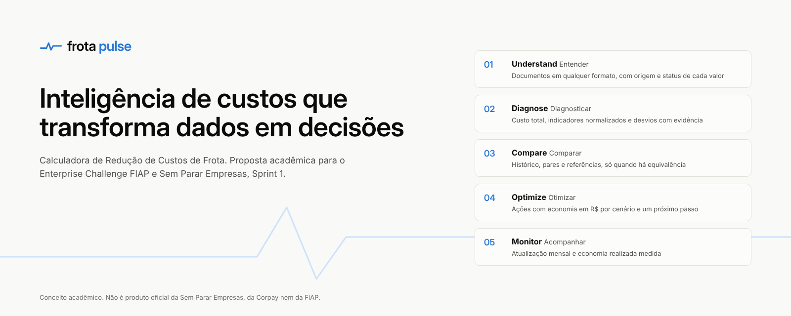
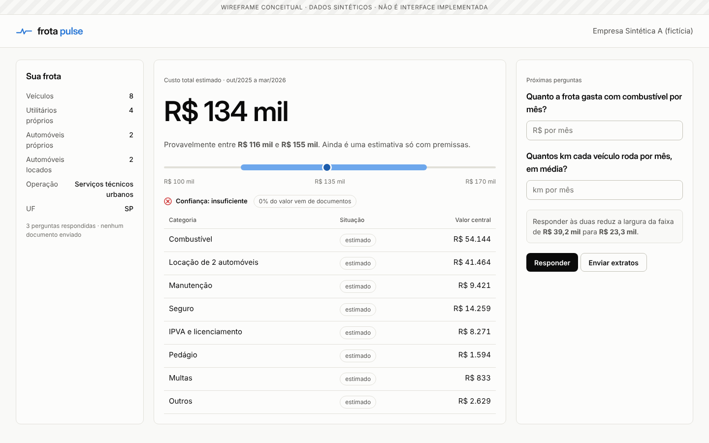
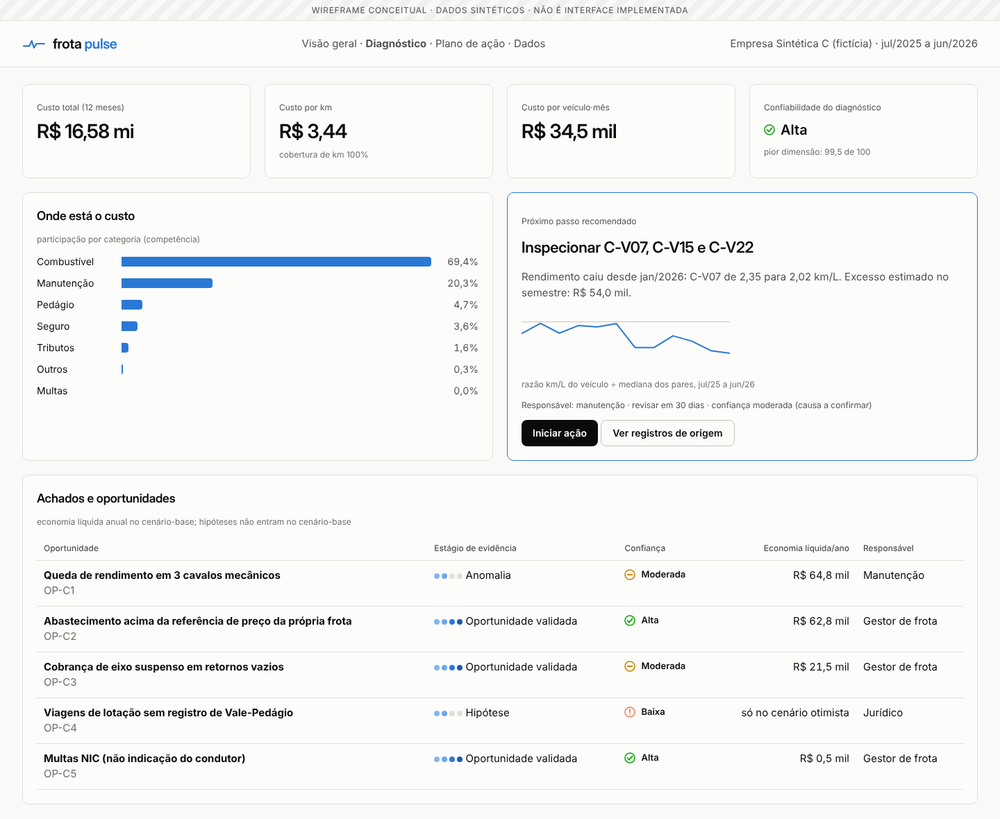
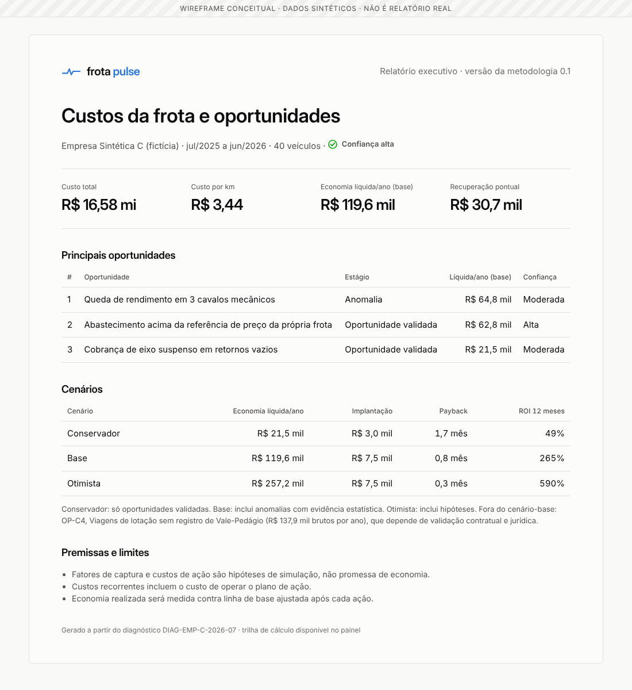

# UX, interface e identidade visual

Tudo aqui é **conceitual**: identidade visual e telas propostas para um produto que ainda não existe. Os wireframes usam números da massa sintética e não representam interface implementada.

## 1. Direção

Produto B2B de tecnologia financeira aplicada a mobilidade. Quem usa decide sobre dinheiro; a interface precisa transmitir **precisão e calma**, não entusiasmo.

- **Base neutra e contida.** Fundos claros e quentes, tinta quase preta, linhas finas. Um único acento, o azul "pulso".
- **Os dados são o elemento mais forte da tela.** Números grandes em sans, gráficos com poucas marcas, grade recessiva.
- **Cor só quando carrega significado:** identidade de série, magnitude, estado (confiança) ou estágio de evidência. Nada de gradientes decorativos, ilustrações ou emojis.
- **Incerteza sempre visível.** Estimativas aparecem como faixa, com a parcela observada e um selo de confiança.

**Marca.** O símbolo é uma linha de pulso que termina mais alta do que começa, ou seja, sinal de melhora. Ao lado vem o nome em minúsculas, com "pulse" no azul de acento. Logotipos da Sem Parar Empresas, da Corpay e da FIAP não são usados nem alterados; o logo da FIAP aparece apenas no cabeçalho do README, como exige o template.

## 2. Tokens

Arquivo-fonte: [`assets/fontes/estilo.css`](../assets/fontes/estilo.css). Contraste medido com a fórmula de luminância relativa da WCAG.

| Token | Claro | Escuro | Uso | Contraste (claro / escuro) |
|---|---|---|---|---|
| `--pagina` | `#f9f9f7` | `#0d0d0d` | Fundo da página | - |
| `--superficie` | `#fcfcfb` | `#1a1a19` | Cartões e gráficos | - |
| `--tinta` | `#0b0b0b` | `#ffffff` | Texto principal | 19,17:1 / 17,42:1 |
| `--tinta-2` | `#52514e` | `#c3c2b7` | Texto secundário | 7,73:1 / 9,72:1 |
| `--mudo` | `#6f6e69` | `#898781` | Legendas, eixos, notas | 4,98:1 / 4,85:1 |
| `--pulso` | `#2a78d6` | `#3987e5` | Acento, série principal, marca | 4,19:1 sobre a página (só em texto grande) / 4,79:1 |
| `--pulso-escuro` | `#1c5cab` | `#86b6ef` | Links e destaque em texto | 6,46:1 no claro |
| `--bom-texto` | `#006300` | `#0ca30c` | Texto de variação positiva | 7,35:1 no claro |
| `--linha` | `#e1e0d9` | `#2c2c2a` | Divisórias e grade | elemento não textual |

**Decisão de acessibilidade.** A paleta de referência usada nos gráficos traz `#898781` como cinza de eixos e rótulos. No fundo claro ele mede 3,50:1, abaixo dos 4,5:1 exigidos para texto (WCAG 2.2, critério 1.4.3). O projeto substituiu esse tom no modo claro por `#6f6e69`, o cinza mais claro que passa nos dois fundos (4,98:1 e 4,85:1). No modo escuro, `#898781` já passa (4,85:1).

## 3. Tipografia

| Papel | Fonte | Tamanho e peso | Observação |
|---|---|---|---|
| Número principal (um por tela) | Inter Display | 48 a 56 px, semibold | Algarismos proporcionais |
| Títulos | Inter Display | 20 a 34 px, semibold | Espaçamento entre letras levemente negativo |
| Texto | Inter | 15 px, regular, entrelinha 1,5 | - |
| Rótulos e notas | Inter | 12 a 13 px | Cor `--tinta-2` ou `--mudo` |
| Tabelas e eixos | Inter | 12 a 14 px | `tabular-nums` para alinhar colunas |

Números seguem o padrão brasileiro: R$ 1.234,56; 3,44 R$/km; 75,6%.

## 4. Cor com função

| Função | Codificação | Regra |
|---|---|---|
| Identidade de série (gráficos) | Paleta categórica de referência, na ordem fixa azul `#2a78d6`, laranja `#eb6834` e verde-água `#1baf7a` | Validada por script: as 3 cores passam nas verificações de daltonismo (diferença mínima entre pares de 9,2) e de visão normal (27,6 entre vizinhas). O verde-água tem 2,74:1 de contraste, então gráficos que o usam levam rótulos diretos e têm tabela equivalente no [anexo](anexos/exemplos-calculados.md) |
| Magnitude e ordem (cenários) | Rampa de um só azul, do claro ao escuro | Cenário conservador mais claro, otimista mais escuro |
| Confiança do diagnóstico | Estado: Alta (verde), Moderada (amarelo), Baixa (laranja), Insuficiente (vermelho) | Sempre ícone **e** rótulo em tinta; a cor nunca sozinha. Cores de estado não são usadas como cor de série |
| Estágio de evidência | Quatro pontos em rampa azul mais o nome do estágio | Observação (1), Anomalia ou Hipótese (2), Oportunidade validada (4) |
| Observado × estimado | Azul cheio × azul claro, com o rótulo "estimado" | Estimativa nunca aparece com a mesma aparência de dado observado |

Os ícones de estado repetem o rótulo, que é a informação principal. Por isso o amarelo e o laranja, abaixo de 3:1 no fundo claro, não são o único meio de leitura.

## 5. Wireframes conceituais

Gerados por [`src/gerar_visuais.py`](../src/gerar_visuais.py) a partir dos resultados calculados; as fontes HTML editáveis estão em [`assets/fontes/`](../assets/fontes/).

### Primeira estimativa (gestor de frota, nível N0)

Atende a US-GF-09, US-GF-10 e US-SP-04: valor no primeiro uso, faixa honesta e perguntas que melhoram a estimativa.

### Diagnóstico do gestor (EMP-C)

Atende a US-GF-02, US-GF-03, US-GF-05, US-GF-06 e US-GF-07: custo consolidado, onde está o custo, achados por estágio de evidência e um único próximo passo.

### Relatório executivo (CFO)

Atende a US-CF-01 e US-CF-02: uma página, cenários, payback, ROI, selo de confiança e premissas.

## 6. Jornadas

### Gestor de frota: importar, validar, compreender e agir

| Etapa | Ação do usuário | Resposta do produto | User Stories |
|---|---|---|---|
| 1. Começar | Informa composição da frota, segmento e UF (3 perguntas) | Faixa de custo total, selo "insuficiente" e as próximas perguntas | GF-09, GF-10, SP-04 |
| 2. Responder | Informa gasto mensal com combustível e km médio | Faixa mais estreita, com o ganho mostrado | GF-09, GF-10 |
| 3. Enviar documentos | Arrasta extratos, PDFs e fotos | Recebe, processa em segundo plano e avisa o que precisa de revisão | GF-01 |
| 4. Validar | Revisa registros com baixa confiança lado a lado com o recorte do documento | Corrige, guarda o valor original e atualiza os totais | GF-01 |
| 5. Compreender | Abre o diagnóstico | Custo consolidado, indicadores, comparações com referência explícita e selo | GF-02, GF-03, GF-04 |
| 6. Agir | Abre o próximo passo e as oportunidades | Ação com responsável, economia por cenário e associação ao portfólio quando aplicável | GF-05, GF-06, GF-07, SP-01 |
| 7. Voltar no mês seguinte | Envia novos extratos | Variação, novos achados e economia realizada das ações concluídas | GF-08, SP-05 |

### CFO: decidir com cenários

| Etapa | Ação | Resposta | User Stories |
|---|---|---|---|
| 1 | Recebe o relatório (PDF ou link) | Uma página: custo total, R$/km, três oportunidades, cenários e selo | CF-01 |
| 2 | Questiona um número | Link para a trilha de cálculo: premissa, fórmula e registros | CF-02 |
| 3 | Aprova o plano | Ações passam a ter acompanhamento e medição de economia realizada | CF-04 |

### Sem Parar Empresas: oportunidades com autorização

| Etapa | Ação | Resposta | User Stories |
|---|---|---|---|
| 1 | Analista abre o painel interno | Contagens agregadas por tipo de oportunidade e porte; detalhe só de clientes que autorizaram contato | SP-02 |
| 2 | Abre uma oportunidade autorizada | Empresa, achados, valor estimado e solução relacionada, com registro em auditoria | SP-01, SP-02, SP-06 |
| 3 | Acompanha a evolução das referências | Versão das referências, número de empresas e resultado do backtest | SP-03 |

## 7. Acessibilidade (meta: WCAG 2.2, nível AA)

- Texto com 4,5:1 ou mais; componentes e gráficos com 3:1 ou mais, com rótulos onde a cor não alcança.
- Cor nunca é o único meio: estado com ícone e rótulo; estimado com rótulo; séries com legenda e rótulos diretos.
- Todo gráfico tem tabela equivalente.
- Navegação completa por teclado, foco visível e ordem de leitura lógica.
- Modo escuro com tokens próprios, medidos contra a superfície escura, e não inversão automática.
- Movimento reduzido respeitado; nenhuma animação carrega informação.
- Linguagem simples: "faixa provável" em vez de "P10-P90"; termos técnicos explicados ao passar o cursor e no glossário.

## 8. Linguagem do produto

| Usar | Evitar | Motivo |
|---|---|---|
| "Economia estimada", "pode reduzir" | "Economia garantida", "vai economizar" | Estimativa não é promessa |
| "Faixa provável" | "Valor exato" | A incerteza é real |
| "Encontramos um sinal; confirme a causa" | "Detectamos desperdício" | Anomalia não é ineficiência |
| "Esta solução da Sem Parar Empresas pode ajudar a executar a ação" | "Contrate X para economizar Y" | A associação é contextual |
| "Ainda não comparamos: faltam 2 veículos para o mínimo" | Esconder a comparação sem explicar | Transparência |

## 9. Gráficos da documentação

Gerados por [`src/gerar_graficos.py`](../src/gerar_graficos.py) seguindo as especificações do método de visualização adotado: linhas de 2 px, barras de no máximo 24 px com ponta arredondada e base reta, grade em linha fina sólida, rótulos diretos seletivos, legenda quando há duas séries ou mais, texto sempre em tinta e nunca na cor da série, e nenhum gráfico com dois eixos verticais.

| Gráfico | Arquivo | Onde é usado |
|---|---|---|
| Estimativa progressiva | [`estimativa-progressiva.svg`](../assets/graficos/estimativa-progressiva.svg) | Diagnóstico, vídeo |
| Decomposição LMDI | [`decomposicao-lmdi.svg`](../assets/graficos/decomposicao-lmdi.svg) | Benchmarks, vídeo |
| CUSUM de C-V07 | [`cusum-c-v07.svg`](../assets/graficos/cusum-c-v07.svg) | Diagnóstico |
| Caixa × competência | [`caixa-competencia.svg`](../assets/graficos/caixa-competencia.svg) | Modelagem de dados |
| Cenários de economia | [`cenarios-economia.svg`](../assets/graficos/cenarios-economia.svg) | Economia, vídeo |

Por serem imagens estáticas, não têm camada de interação (dica ao passar o cursor). No produto, os gráficos equivalentes terão dica, foco por teclado e tabela.
